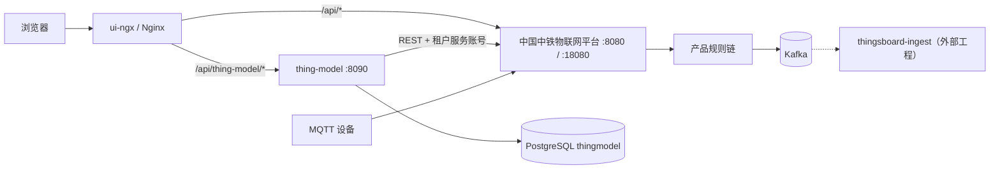

# 2 架构与数据模型

> 中国中铁物联网平台文档集｜[总目录](../README.md)｜上一篇 [平台概览](01-平台概览.md)｜下一篇 [物模型与校验](03-物模型与校验.md)

## 2.1 组件关系



| 组件 | 职责 |
| --- | --- |
| 中国中铁物联网平台 | 租户与用户、设备、凭证、设备配置、资产、规则链、RPC、OTA、遥测存储 |
| `thing-model` | 产品与 TSL、租户服务账号、设备模板/资产/规则链同步、Kafka 消息生成 |
| `ui-ngx` | 中国中铁物联网平台前端定制，包含产品页面和租户服务账号弹窗 |
| PostgreSQL | `thing-model` 的 `plat_*` 表；与中国中铁物联网平台数据库隔离 |
| Kafka | 接收规则链输出的遥测、事件和非法数据 |
| `thingsboard-ingest` | 本仓库外部工程，消费 Kafka 并写入 TDengine/事件库；本仓库不包含其代码 |

## 2.2 请求链路

### 浏览器访问 `thing-model`

```text
浏览器
  -> /api/thing-model/products
  -> 开发代理或 Nginx 重写为 /api/products
  -> thing-model :8090
  -> 校验 X-Authorization 中的中国中铁物联网平台 JWT
  -> 读取 JWT 对应的 tenantId / authority
```

前端路径带 `/api/thing-model` 只是为了与中国中铁物联网平台的 `/api` 区分。直接访问 `thing-model` 时使用 `/api/...`。

### 写入中国中铁物联网平台

```text
thing-model
  -> 从 plat_vendor_account 读取目标租户的租户管理员
  -> 解密密码并登录中国中铁物联网平台
  -> 以该租户身份保存设备配置、资产和规则链
```

产品接口只允许租户管理员，产品租户来自 JWT，不接受请求体跨租户指定。管理接口只允许系统管理员。

## 2.3 部署拓扑

### 独立数据库（默认）

```text
PostgreSQL:5432
├── thingsboard   中国中铁物联网平台元数据
└── thingmodel    thing-model 的 plat_* 与 flyway_schema_history
```

默认配置：

```text
SPRING_DATASOURCE_URL=jdbc:postgresql://localhost:5432/thingmodel
THINGMODEL_DB_NAME=thingmodel
THINGMODEL_DB_SCHEMA=
```

`DatabaseGuard` 校验当前数据库名，防止误连 `thingsboard`。

### 同库独立 schema（可选）

```text
PostgreSQL:5432
└── thingsboard
    ├── public       中国中铁物联网平台元数据
    └── thingmodel   thing-model 的 plat_* 与 flyway_schema_history
```

```text
SPRING_DATASOURCE_URL=jdbc:postgresql://localhost:5432/thingsboard
THINGMODEL_DB_NAME=thingsboard
THINGMODEL_DB_SCHEMA=thingmodel
```

两种模式只能选一种，`THINGMODEL_DB_SCHEMA` 为空表示独立数据库。

## 2.4 数据表

Flyway 依次执行：

| 迁移 | 内容 |
| --- | --- |
| `V1__plat_tsl.sql` | 产品、TSL、属性/事件/行为目录、模板绑定 |
| `V2__plat_vendor_account.sql` | 厂商中国中铁物联网平台服务账号 |
| `V3__tenant_scoped_product.sql` | 产品改为租户隔离，重建所有产品相关表 |
| `V4__global_unique_product_id.sql` | 增加 产品 ID 全系统唯一约束 |

V3 完成后实际表结构如下。

### `plat_product`

| 字段 | 说明 |
| --- | --- |
| `tenant_id` | 厂商租户 UUID，联合主键 |
| `product_id` | 产品 ID，联合主键 |
| `name` / `model` / `category_id` / `vendor` | 产品主数据 |
| `auth_type` | 当前固定写入 `ACCESS_TOKEN` |
| `protocol` | 当前固定写入 `MQTT` |
| `created_at` / `updated_at` | 时间戳 |

主键：`(tenant_id, product_id)`。产品 ID 额外受全系统唯一约束，不同租户也不能重复。

### `plat_product_tsl`

| 字段 | 说明 |
| --- | --- |
| `id` | 自增主键 |
| `tenant_id` / `product_id` / `version` | 唯一键 |
| `checksum` | TSL 内容 SHA-256 |
| `strict_unknown` | 规则链是否拒绝未知键 |
| `tsl_json` | TSL 原文 JSONB |
| `status` | `DRAFT` / `PUBLISHED` / `DEPRECATED` |
| `published_at` / `created_at` | 时间戳 |

唯一键：`(tenant_id, product_id, version)`。同一版本内容不同会返回 `409 TSL_VERSION_EXISTS`。

### TSL 目录表

| 表 | 主键 | 用途 |
| --- | --- | --- |
| `plat_tsl_property` | `(tenant_id, product_id, tsl_version, property_key)` | 属性目录、类型、范围、单位、模式 |
| `plat_tsl_event` | `(tenant_id, product_id, tsl_version, event_id)` | 事件定义和参数 |
| `plat_tsl_action` | `(tenant_id, product_id, tsl_version, action_id)` | 行为输入/输出定义 |

### `plat_profile_binding`

记录一次 TSL 版本对应的中国中铁物联网平台资源：

| 字段 | 说明 |
| --- | --- |
| `tenant_id` / `product_id` / `tsl_version` | 联合主键 |
| `tb_profile_id` | 设备配置 ID |
| `tb_asset_id` | 产品资产 ID |
| `tb_rule_chain_id` | 产品规则链 ID |
| `schema_version` | 压缩 schema 版本，当前为 `1.0` |
| `sync_result` | `OK` 或失败信息，最多 2000 字符 |
| `synced_at` | 最近同步时间 |

### `plat_vendor_account`

| 字段 | 说明 |
| --- | --- |
| `tenant_id` | 主键 |
| `username` | 租户管理员账号 |
| `password_cipher` | AES-GCM 加密后的密码 |
| `enabled` | 是否启用 |
| `created_at` / `updated_at` | 时间戳 |

## 2.5 实体映射

| 平台对象 | 中国中铁物联网平台实体 | 命名规则 |
| --- | --- | --- |
| 产品 | 设备配置 | `产品名称 + 空格 + 型号`；型号为空或等于名称时只使用名称 |
| 产品元数据 | 资产 | 产品 <产品 ID>，类型 `product` |
| 产品规则链 | 规则链 | 名称等于 产品 ID |
| 产品实例 | 设备 | `Device.name` 由中国中铁物联网平台或运维脚本创建 |
| 物模型 | 资产属性 + `plat_*` 表 | TSL 权威源在 `plat_product_tsl` |
| 厂商身份 | 租户管理员 | 每个租户一个专用服务账号 |

设备配置描述格式：

```text
ProductId=<id>; CategoryId=<id>; TSL v<version>; 属性 <n> 个; 事件 <n> 个; 行为 <n> 个
```

产品资产写入的 `SERVER_SCOPE` 属性：

```text
product_id, category_id, tsl_version,
property_count, event_count, action_count,
tsl_json, tsl_schema, strict_unknown
```

## 2.6 数据归属与边界

| 数据 | 归属 | 访问方式 |
| --- | --- | --- |
| 租户、用户、设备、凭证、设备配置、资产、规则链 | 中国中铁物联网平台 | `thing-model` 通过 REST 读写 |
| 产品主数据、TSL、目录、绑定记录、服务账号 | `thing-model` PostgreSQL | 自有库读写 |
| 遥测与事件原始数据 | 中国中铁物联网平台 / Kafka | 规则链写入 TB 并投递 Kafka |
| TDengine 与事件中心 | 外部 `thingsboard-ingest` | 不在本仓库实现 |

不要跨库 JOIN。中国中铁物联网平台实体 ID 与 `plat_*` 记录通过 `(tenant_id, product_id)` 和 `plat_profile_binding` 关联。

## 2.7 相关代码

| 模块 | 位置 |
| --- | --- |
| 服务入口 | `thing-model/src/main/java/com/iot/thingmodel/ThingModelServiceApplication.java` |
| 数据库迁移 | `thing-model/src/main/resources/db/migration/` |
| 产品服务 | `thing-model/src/main/java/com/iot/thingmodel/product/ProductService.java` |
| 数据访问 | `thing-model/src/main/java/com/iot/thingmodel/product/ProductRepository.java` |
| 中国中铁物联网平台同步 | `thing-model/src/main/java/com/iot/thingmodel/sync/` |
| 厂商账号 | `thing-model/src/main/java/com/iot/thingmodel/admin/` |
| 认证与权限 | `thing-model/src/main/java/com/iot/thingmodel/auth/` |
