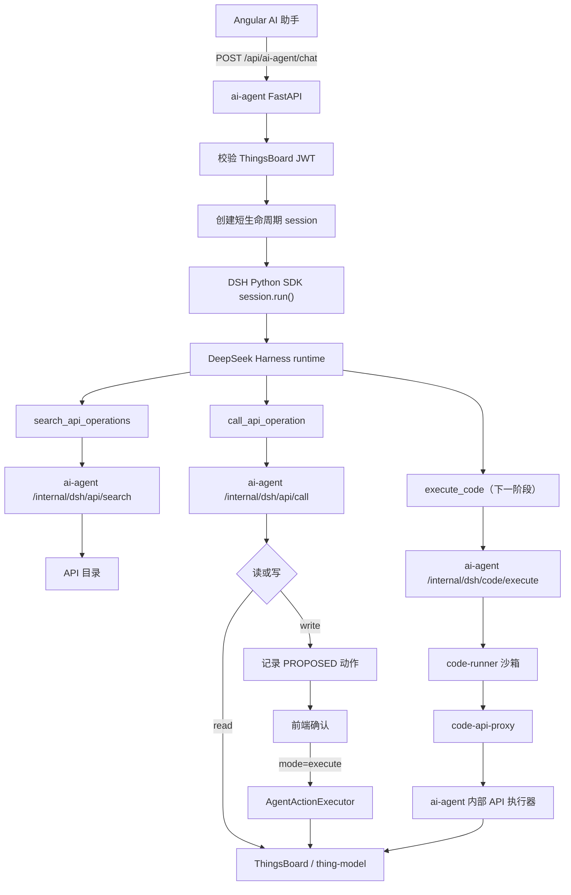
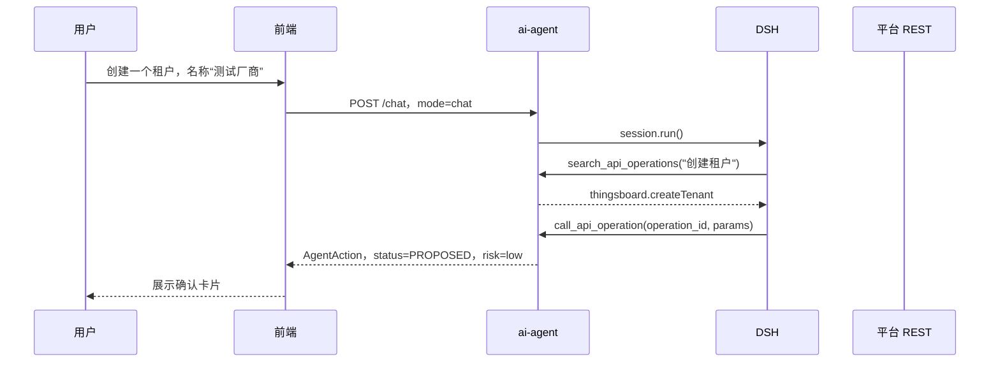
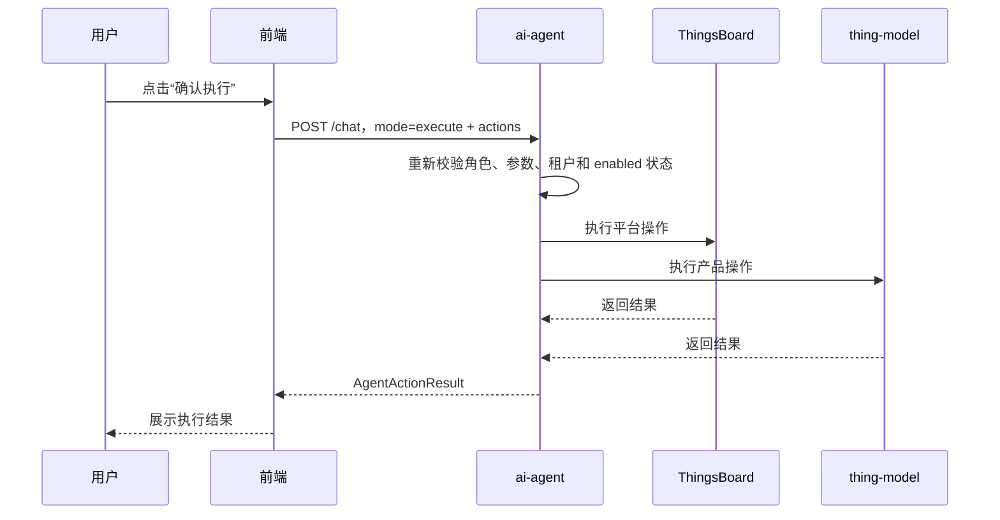

# 11 AI Agent 对话助手与 DSH 接入方案

> 中国中铁物联网平台文档集｜[总目录](../README.md)｜上一篇 [租户与产品快速使用手册](10-租户与产品快速使用手册.md)｜下一篇 [视频网关](14-视频网关.md)

本文统一描述 AI Agent 对话助手、DSH 编排接入、统一 API 目录、权限与确认、代码执行沙箱和操作演示。
当前已实现 DSH runtime、API 目录、`search_api_operations` / `call_api_operation`、写操作确认和文件上传下载；
`execute_code`、`code-runner`、`code-api-proxy` 属于下一阶段能力。

## 11.1 目标与边界

目标：

- 前端保留全局 AI 对话助手，后端保持 `POST /api/ai-agent/chat` 协议不变。
- 用 DSH 替换 `orchestrator.py` 中的模型规划循环，同时保留 `AI_AGENT_ENGINE=openai` 回滚路径。
- 用“一份 API 目录 + 通用执行器”接入 ThingsBoard 与 thing-model 的全部 OpenAPI 接口，新增接口只需更新目录。
- DSH 只暴露三个通用工具：`search_api_operations`、`call_api_operation`、`execute_code`。
  - 当前已实现前两个。
  - `execute_code` 及沙箱链路属于下一阶段。
- 读接口立即执行；普通写接口只生成 `PROPOSED` 动作，用户确认后才执行。
- 代码写操作走执行级确认；沙箱只能访问 ThingsBoard 和 thing-model，不能访问互联网或宿主机文件。
- ThingsBoard JWT 只保存在 `ai-agent` 内存中，不进入 DSH、`code-runner`、`code-api-proxy` 或模型上下文。

当前不做：

- SSE 流式输出。
- 聊天记录持久化和跨设备会话恢复。
- 多 Agent 协作和持久化工作流。
- 让模型直接指定 host、base URL 或 HTTP 方法。

### 11.1.1 实施状态

| 能力 | 状态 |
| --- | --- |
| DSH runtime + OpenAI 兼容回滚 | 已实现 |
| 统一 API 目录、`search_api_operations`、`call_api_operation` | 已实现 |
| 普通写操作 `PROPOSED -> execute` | 已实现 |
| 高危标记 `risk` 与前端提示 | 已实现 |
| 文件上传（仅用于模型上下文） | 已实现 |
| `execute_code`、`code-runner`、`code-api-proxy`、`execution_token` | 规划中 |

## 11.2 总体架构



核心边界：

- `ai-agent` 负责鉴权、会话上下文、权限校验、工具执行、动作确认和最终业务调用。
- `ai-agent` 是唯一出站 REST 层，继续复用现有 `ThingsBoardClient` 和 `ThingModelClient`。
- DSH 负责模型规划、工具选择和对话生成，只拿到不可猜测的 `session_id`。
- 模型只传 `operation_id` 和参数，或 `execute_code` 的代码、语言和 `allowed_operations`；不能传 URL、HTTP 方法或后端地址。
- `code-runner`、`code-api-proxy` 是下一阶段组件；当前业务调用全部由 `ai-agent` 完成。

## 11.3 前端设计

新增文件：

```text
ui-ngx/src/app/modules/home/components/ai-agent/
  ai-agent.component.ts
  ai-agent.component.html
  ai-agent.component.scss
ui-ngx/src/app/core/http/ai-agent.service.ts
ui-ngx/src/app/shared/models/ai-agent.models.ts
```

在 `home.component.html` 挂载：

```html
<tb-ai-agent></tb-ai-agent>
```

界面能力：

- 右下角悬浮按钮，仅系统管理员和租户管理员显示。
- 点击打开聊天面板，支持文字输入、历史消息展示和文件上传。
- 只读操作直接返回结果；写操作展示待确认动作卡片。
- 动作卡片展示动作类型、目标对象、关键参数和风险等级。
- 高危动作展示“高危操作”标识和影响范围。
- 提供“确认执行”和“取消”；确认后再次调用同一个 API，使用 `mode=execute`。
- 支持上传任意附件；JSON/Text/CSV 会作为附件上下文提供给模型，TSL 不再使用单独的粘贴入口。
- 附件只用于模型理解，不提供下载。
- AI 不生成或返回文件，所有操作结果只显示在对话框文本中。
- 代码写操作在执行前展示完整代码、语言、超时时间、`allowed_operations`、最高风险等级和写操作数量上限。
- 聊天记录只保存在前端内存。

前端模型：

```ts
export type AgentMode = 'chat' | 'execute';
export type AgentActionRisk = 'low' | 'medium' | 'high';

export interface AgentFile {
  id: string;
  name: string;
  mime_type: string;
  size: number;
}

export interface AgentMessage {
  role: 'user' | 'assistant';
  content: string;
  files?: AgentFile[];
}

export interface AgentAction {
  id: string;
  type: string;
  summary: string;
  params: Record<string, unknown>;
  status?: 'PROPOSED' | 'EXECUTED' | 'FAILED';
  risk?: AgentActionRisk;
}

export interface AgentChatRequest {
  mode: AgentMode;
  messages: AgentMessage[];
  tsl?: unknown;
  files?: AgentFile[];
  actions?: AgentAction[];
  context?: {
    route?: string;
    product_id?: string;
    tenant_id?: string;
  };
}

export interface AgentActionResult {
  action_id: string;
  type: string;
  success: boolean;
  message: string;
  data?: Record<string, unknown>;
}

export interface AgentChatResponse {
  reply: string;
  actions: AgentAction[];
  executed: AgentActionResult[];
  files?: AgentFile[];
}
```

## 11.4 Python 后端技术选型

```text
Python 3.12
uv
FastAPI
Pydantic
AsyncOpenAI（OpenAI 兼容回退）
deepseek-harness-sdk（DSH 编排）
httpx
PyYAML
pytest + respx
uvicorn
Docker
```

选择理由：

- FastAPI 提供异步 API、Pydantic 校验和 OpenAPI 文档。
- Pydantic 定义工具参数、请求和响应模型，服务端重新校验模型输出。
- AsyncOpenAI 保留原有 OpenAI 兼容编排路径，可通过 `AI_AGENT_ENGINE=openai` 回滚。
- `deepseek-harness-sdk` 启动 DSH runtime，用统一 API 目录覆盖全部平台接口。
- httpx 继续作为 ThingsBoard / thing-model 的唯一 REST 客户端。

### 服务目录

```text
ai-agent/
  app/
    main.py
    config.py
    cli.py
    api/
      agent.py              POST /chat
      files.py              POST /files 上传附件
      internal.py           DSH 内部工具接口
      health.py             GET /health、GET /ready
    auth/
      thingsboard.py        JWT 校验与缓存
    agent/
      dsh.py                DSH runtime 生命周期
      orchestrator.py       对话、工具规划、确认执行
      llm.py                OpenAI 兼容客户端
      api_catalog.py        API 目录加载、搜索、参数校验
      api_executor.py       通用 API 执行器
      tool_gateway.py       搜索/调用/写提案
      executor.py           白名单动作执行与权限校验
      sessions.py           DSH 短期会话上下文
      files.py              上传附件存储
      models.py             请求/响应和动作模型
      prompts.py            系统提示词
    clients/
      thingsboard.py
      thing_model.py
  config/api/
    thingsboard.yaml
    thing_model.yaml
    manual_apis.yaml
    overrides.yaml
  dsh/
    thingsboard.patch.yml
  dsh-plugin-thingsboard/
    index.js
  scripts/
    import_openapi.py
    import_manual_apis.py
  tests/
```

### DSH 运行时配置

在 `pyproject.toml` 固定 SDK 版本：

```toml
dependencies = [
  "deepseek-harness-sdk==0.2.1rc2",
]
```

`ai-agent` 启动时创建一个复用的 DSH runtime 实例：

```python
from deepseek_harness import DeepSeekHarness

harness = DeepSeekHarness(
    dsh_home=settings.dsh_home,
    cwd=settings.dsh_workspace,
    profile=settings.dsh_profile,
    patches=(generated_patch_path,),
    provider=settings.dsh_provider,
    model=settings.dsh_model,
    api_key=settings.deepseek_api_key or settings.openai_api_key,
    base_url=settings.deepseek_base_url,
    max_tokens=settings.max_tokens,
    request_timeout_seconds=settings.dsh_timeout_seconds,
    env={
        "DSH_SYSTEM_PROMPT": DSH_SYSTEM_PROMPT,
        "THINGSBOARD_AGENT_URL": settings.internal_agent_url,
        "THINGSBOARD_AGENT_TOKEN": internal_token,
    },
)
```

要求：

- `dsh_home` 必须是显式路径，不能依赖 `~/.dsh`。
- `cwd` 使用独立空目录，不挂载业务代码。
- DSH runtime 与 `ai-agent` 同 Pod 运行，由 `ai-agent` 管理生命周期。
- DSH 进程退出、超时或初始化失败时，返回统一的 `AgentUnavailable`。

### DSH profile 与工具限制

第一版使用 `sdk-minimal` 加 `dsh/thingsboard.patch.yml`：

- 保留 SDK JSON-RPC server、DeepSeek adapter、tools、sessions。
- 禁用 `persistent-bash`、`persistent-pwsh`、`terminal-*`、`pty`、`tool-working-directory`、`mcp-resources`。
- 关闭 `tool-fs` 的 `read`、`readImage`、`write`、`edit`。
- 插入 `dsh-plugin-thingsboard`；当前注册 `search_api_operations` 和 `call_api_operation`，`execute_code` 实现后扩展为三个工具。

插件在 `apply(ctx)` 中：

1. 注册通用工具。
2. 调用 `ctx.tools.restrict` 限制模型可见工具。
3. 不在插件中保存 JWT 或业务密钥。
4. 通过 `THINGSBOARD_AGENT_URL` 和 `THINGSBOARD_AGENT_TOKEN` 回调 `ai-agent` 内部接口。

上线前必须验证：

- 模型看不到 `bash`、`pwsh`、`read_image`、`working_directory` 等内置工具。
- 模型只能调用当前允许的通用工具。
- `exec.agent.id` 与 `ai-agent` 传入的 `session_id` 一致。

### 系统提示词与对话历史

通过 `DSH_SYSTEM_PROMPT` 设置基础提示词，核心约束包括：

- 当前角色是物联网平台管理助手。
- 任何 ThingsBoard 或 thing-model 操作必须先调用 `search_api_operations`。
- 找到 `operation_id` 后再调用 `call_api_operation`。
- 不得编造 `operation_id`。
- 不得尝试访问目录之外的接口。
- 写操作只生成待确认动作，不声称已经执行。
- 代码执行只能通过 `execute_code`，不能尝试使用 shell、文件或网络工具。
- 只读代码可以直接执行；包含写操作的代码必须声明 `access: write` 和完整的 `allowed_operations`。
- 不在代码中硬编码 JWT、密码、API Key 或内部地址。
- 不输出 JWT、密码、API Key、完整 TSL。

每次请求的 `authority`、`tenant_id`、是否有 TSL 作为 `[运行上下文]` 写入输入，避免 DSH 进程级环境变量无法按请求变化。

当前前端每次请求都发送完整 `messages`。第一版采用无状态方式：

- 每次请求生成新的 DSH `session_id`。
- 将最近 `AI_AGENT_MAX_MESSAGES` 条消息格式化为结构化上下文，作为 `session.run()` 输入。
- 运行结束后清理 DSH session，避免长期累积。

后续如果前端增加稳定的 `conversation_id`，可以改为复用 DSH 持久会话，减少重复上下文。

## 11.5 Agent API 与鉴权

公开 API：

```http
POST /chat
POST /files
GET  /files/{fileId}
GET  /health
GET  /ready
```

内部 API：

```text
POST /internal/dsh/api/search
POST /internal/dsh/api/call
POST /internal/dsh/code/execute     （下一阶段）
POST /internal/dsh/code/authorize   （下一阶段）
POST /internal/dsh/code/proxy       （下一阶段）
```

约束：

- `/chat` 校验平台 JWT，允许系统管理员、租户管理员和客户用户按目录权限调用。
- JWT 通过 `GET /api/auth/user` 校验，结果按令牌哈希缓存 60 秒。
- `ai-agent` 不持久化 JWT，不记录 JWT、密码或完整敏感参数。
- 内部接口只监听集群内部地址，DSH 回调使用 `AI_AGENT_INTERNAL_TOOL_TOKEN` 和 `X-Internal-Token`。
- `code-api-proxy` 使用独立的 `AI_AGENT_CODE_PROXY_SECRET`，与 DSH 内部 token 分离。

## 11.6 API 目录与通用执行

### 目录文件

```text
ai-agent/config/api/
├── thingsboard.yaml      ThingsBoard OpenAPI 自动生成
├── thing_model.yaml      thing-model OpenAPI 自动生成
├── manual_apis.yaml      使用手册补充的接口
└── overrides.yaml        人工覆盖项
```

### 目录项结构

```yaml
- id: thingsboard.listTenants
  service: thingsboard
  method: GET
  path: /api/tenants
  summary: 查询租户列表
  aliases: [租户, 厂商, tenant]
  tags: [tenant]
  mode: read
  code_access: read
  permission: SYS_ADMIN
  risk: low
  enabled: true
  params:
    pageSize:
      in: query
      type: integer
      default: 100
    page:
      in: query
      type: integer
      default: 0
```

字段说明：

| 字段 | 必填 | 说明 |
| --- | --- | --- |
| `id` | 是 | 稳定唯一 ID，建议 `service.operationId` |
| `service` | 是 | `thingsboard` 或 `thing_model` |
| `method` | 是 | `GET`、`POST`、`PUT`、`PATCH`、`DELETE` |
| `path` | 是 | 以 `/` 开头的相对路径，不含 host |
| `summary` | 是 | 模型和前端看到的简短说明 |
| `aliases` | 否 | 搜索别名，支持中文 |
| `tags` | 否 | 搜索和分组标签 |
| `mode` | 是 | `read` 立即执行；`write` 生成待确认动作 |
| `code_access` | 是 | `read`、`write`、`none`；控制代码沙箱可调用的接口 |
| `permission` | 是 | `ANY`、`TENANT_ADMIN`、`SYS_ADMIN` |
| `risk` | 是 | `low`、`medium`、`high` |
| `enabled` | 是 | 是否允许模型调用 |
| `handler` | 否 | 复杂业务使用自定义处理函数 |
| `params` | 否 | 参数映射和校验规则 |

### 搜索与调用

`search_api_operations`：

- 在 `id`、`summary`、`aliases`、`tags` 中搜索。
- 支持中文、英文和拼音别名。
- 只返回 `enabled: true` 的操作。
- 默认返回 5 条，最多 10 条。
- 返回紧凑参数 schema，避免占用过多上下文。

`call_api_operation`：

- 校验 `operation_id` 是否存在且已启用。
- 校验参数类型、必填项和枚举值。
- 校验用户权限和租户边界。
- 读操作立即调用后端。
- 写操作只创建 `AgentAction`，不调用后端。
- 所有错误都返回结构化 JSON，不抛异常给模型。

### 通用执行与 handler

- 现有操作继续复用原显式方法和 handler。
- 新增接口默认走 `ApiExecutor` 通用执行。
- 复杂业务保留 handler，例如创建租户后初始化服务账号、创建产品时使用会话 TSL、创建设备后写服务端属性。
- `ApiExecutor` 只负责按目录选择客户端、组装参数、调用 `request`，不新建第二套 HTTP 栈。

### OpenAPI 导入与 overrides

```bash
python scripts/import_openapi.py \
  --service thingsboard \
  --spec application/target/openapi.json \
  --out config/api/thingsboard.yaml \
  --overrides config/api/overrides.yaml

python scripts/import_openapi.py \
  --service thing_model \
  --spec http://localhost:8090/v3/api-docs \
  --out config/api/thing_model.yaml \
  --overrides config/api/overrides.yaml

python scripts/import_manual_apis.py
python scripts/import_manual_apis.py --check
```

默认转换规则：

| OpenAPI 元素 | 目录字段 |
| --- | --- |
| `operationId` | `id = service.operationId` |
| `summary` | `summary`，可被 overrides 覆盖 |
| `GET` | `mode: read`、`code_access: read` |
| `POST/PUT/PATCH/DELETE` | `mode: write`、`code_access: write` |
| 认证、密码、Token、管理员控制台 | `code_access: none` |
| `DELETE`、批量、管理员路径 | `risk: high` |
| 其他写操作 | `risk: medium` |
| 查询类操作 | `risk: low` |

`overrides.yaml` 以 `id` 为键，人工覆盖中文摘要、别名、权限、风险和 `code_access`。
自动导入不得删除人工新增的目录项；删除接口时先生成 diff，人工确认后再删除。

### 响应约束

- 列表接口默认分页，避免一次返回过多数据。
- 响应体超过 `AI_AGENT_API_MAX_RESPONSE_BYTES` 时截断，并提示模型缩小查询范围。
- 响应中的密码、Token、密钥字段自动脱敏。
- 完整 TSL 不进入模型上下文；需要 TSL 的接口使用 handler。

## 11.7 DSH 工具与权限

目标工具集：

| 工具 | 作用 | 状态 |
| --- | --- | --- |
| `search_api_operations` | 搜索平台接口 | 已实现 |
| `call_api_operation` | 调用接口；写操作生成待确认动作 | 已实现 |
| `execute_code` | 在沙箱中执行代码，只读立即执行、写操作执行级确认 | 下一阶段 |

权限模型：

| 权限 | 允许操作 |
| --- | --- |
| `ANY` | 当前登录用户可执行的公共查询 |
| `TENANT_ADMIN` | 租户管理员可执行的本租户操作 |
| `SYS_ADMIN` | 系统管理员可执行的管理操作 |

规则：

- `TENANT_ADMIN` 不能调用 `SYS_ADMIN` 接口。
- 带 `tenantId` 的路径或请求体必须与 JWT 所属租户一致。
- `SYS_ADMIN` 创建租户、租户管理员等操作保留现有校验。
- 所有通用写操作在执行前再次校验，不能只依赖提案时的校验。

## 11.8 确认流程

### 普通写操作

第一轮：模型只生成动作，不执行。



第二轮：用户确认后执行。



未确认的写操作不会落库或调用平台。

### 代码写操作（下一阶段）

```text
execute_code(access=write, allowed_operations=[...])
  -> ai-agent 生成 AgentAction(type=execute_code, status=PROPOSED)
  -> 前端展示完整代码、操作列表、风险等级
  -> 用户确认
  -> ai-agent 启动 code-runner，签发 execution_token
  -> code-runner 通过 code-api-proxy 调用被授权操作
  -> 返回 stdout/stderr/exit_code 和实际调用操作列表
```

## 11.9 代码执行与沙箱（下一阶段）

### execute_code

```json
{
  "language": "python",
  "code": "...",
  "stdin": "...",
  "access": "read",
  "allowed_operations": [],
  "justification": ""
}
```

- `access: read`：只能调用 `code_access: read` 的读接口，立即执行。
- `access: write`：必须列出 `allowed_operations`，走执行级确认。
- 不允许代码直接访问 host、文件系统、互联网或 ThingsBoard JWT。

### code-runner

- 独立沙箱服务，使用 gVisor、Firecracker 或 nsjail。
- 非 root、只读根文件系统、一次性 tmpfs 工作目录。
- 不挂载宿主目录、Docker socket、K8s ServiceAccount Token。
- 不注入 JWT、API Key、数据库密码。
- 限制 CPU、内存、进程数、运行时间和输出大小。
- 只能通过 `code-api-proxy` 访问业务服务。

### code-api-proxy

- 校验 `execution_token` 签名、有效期、执行状态和 session。
- 只允许 `/thingsboard/**` 和 `/thing_model/**`。
- 不接受任意 host、绝对 URL 或 IP 直连。
- 写操作必须在 `allowed_operations` 中，并受 `max_write_operations` 限制。
- 拒绝 `/api/auth/**`、Token、密码、管理员控制台等敏感接口。
- 不持有 ThingsBoard JWT；实际业务调用由 `ai-agent` 完成。

### 代码访问边界

| 目录字段 | 只读代码 | 写代码 |
| --- | --- | --- |
| `code_access: read` | 允许 | 允许 |
| `code_access: write` | 拒绝 | 仅允许 `allowed_operations` 中的操作 |
| `code_access: none` | 拒绝 | 拒绝 |

### 网络策略

| 来源 | 目标 | 端口 | 说明 |
| --- | --- | --- | --- |
| `code-runner` | `code-api-proxy` | 8443 | 唯一出口 |
| `code-api-proxy` | `ai-agent` | 8000 | 内部执行接口 |
| `ai-agent` | ThingsBoard | 8080 | 业务调用 |
| `ai-agent` | thing-model | 8090 | 业务调用 |
| 前端网关 | `ai-agent` | 8000 | 公开 `/chat` |

禁止 `code-runner` 访问互联网、直连业务服务、K8s API 和云元数据。

## 11.10 文件上传

前端 AI 面板支持通用文件上传，仅用于模型理解：

- `POST /files`：上传附件，返回 `AgentFile` 元数据。
- `AgentChatRequest.files`：本次请求附件。
- `AgentMessage.files`：用户消息中的附件元数据。
- 文件 TTL 默认 10 分钟，最大 2MB，绑定用户。
- 上传的文本、JSON、CSV 会作为附件上下文提供给模型。
- TSL JSON 通过通用文件上传并自动识别，已删除单独的粘贴 TSL 功能。
- 不提供 `GET /files/{fileId}` 下载接口。
- AI 不生成或返回文件，所有操作结果只显示在对话框文本中。

## 11.11 配置

```text
AI_AGENT_ENABLED=true
AI_AGENT_ENGINE=openai|dsh
AI_AGENT_OPENAI_BASE_URL=https://api.deepseek.com/v1
AI_AGENT_OPENAI_API_KEY=<secret>
AI_AGENT_OPENAI_MODEL=deepseek-chat
AI_AGENT_DEEPSEEK_API_KEY=<secret>
AI_AGENT_DEEPSEEK_BASE_URL=
AI_AGENT_DSH_HOME=.dsh-home
AI_AGENT_DSH_WORKSPACE=.dsh-workspace
AI_AGENT_DSH_PROFILE=sdk-minimal
AI_AGENT_DSH_PATCH_TEMPLATE=dsh/thingsboard.patch.yml
AI_AGENT_DSH_PLUGIN_PATH=dsh-plugin-thingsboard/index.js
AI_AGENT_DSH_PROVIDER=deepseek-official
AI_AGENT_DSH_MODEL=deepseek-v4-flash
AI_AGENT_DSH_TIMEOUT_SECONDS=60
AI_AGENT_INTERNAL_AGENT_URL=http://127.0.0.1:8000
AI_AGENT_INTERNAL_TOOL_TOKEN=<secret>
AI_AGENT_THING_MODEL_URL=http://thing-model:8090
AI_AGENT_THINGSBOARD_URL=http://thingsboard:8080
AI_AGENT_AUTH_CACHE_SECONDS=60
AI_AGENT_MAX_MESSAGES=20
AI_AGENT_MAX_ACTIONS=10
AI_AGENT_MAX_TOOL_ROUNDS=8
AI_AGENT_API_CATALOG_DIR=config/api
AI_AGENT_API_MAX_RESPONSE_BYTES=262144
AI_AGENT_FILE_TTL_SECONDS=600
AI_AGENT_FILE_MAX_BYTES=2000000
AI_AGENT_FILE_TEXT_MAX_BYTES=65536
```

下一阶段代码执行配置：

```text
AI_AGENT_CODE_EXECUTION_ENABLED=true
AI_AGENT_CODE_WRITE_ENABLED=true
AI_AGENT_CODE_REQUIRE_CONFIRMATION=true
AI_AGENT_CODE_RUNNER_URL=http://code-runner:8080
AI_AGENT_CODE_PROXY_URL=http://code-api-proxy:8443
AI_AGENT_CODE_PROXY_SECRET=<secret>
AI_AGENT_CODE_TOKEN_TTL_SECONDS=40
AI_AGENT_CODE_MAX_REQUESTS=50
AI_AGENT_CODE_MAX_WRITE_OPERATIONS=10
AI_AGENT_CODE_TIMEOUT_SECONDS=30
AI_AGENT_CODE_MAX_CODE_BYTES=65536
AI_AGENT_CODE_MAX_STDIN_BYTES=262144
AI_AGENT_CODE_MAX_OUTPUT_BYTES=262144
AI_AGENT_CODE_MEMORY_MB=512
AI_AGENT_CODE_CPU=1
AI_AGENT_CODE_NETWORK=proxy-only
```

说明：

- `AI_AGENT_ENGINE` 默认 `openai`，灰度通过后再切 `dsh`。
- `AI_AGENT_DEEPSEEK_API_KEY` 只注入 DSH 子进程的 `DEEPSEEK_API_KEY`；为空时回退到 `AI_AGENT_OPENAI_API_KEY`。
- `AI_AGENT_INTERNAL_TOOL_TOKEN` 只用于 DSH 回调 `ai-agent`。
- `AI_AGENT_MAX_MESSAGES` 和 `AI_AGENT_MAX_ACTIONS` 采用队列语义：只保留最近 N 条，超出时静默丢弃最早内容。
- 代码执行相关配置在实现 `execute_code`、`code-runner`、`code-api-proxy` 时启用。

## 11.12 安全要求

- Agent API 必须校验平台 JWT。
- 每个工具独立校验角色和数据范围。
- 所有普通写操作必须二次确认；代码写操作必须执行级确认。
- JWT 只保存在 `ai-agent` 内存中，不写入磁盘、不写日志。
- DSH 只拿到 `session_id`，不接触 JWT。
- 沙箱不注入 JWT、API Key、数据库密码。
- 沙箱不能访问互联网、宿主机文件、K8s API 和云元数据。
- 代码只能通过 `code-api-proxy` 访问目录中允许的接口。
- 响应字段脱敏，过滤 token、password、secret、authorization。
- 审计记录 `session_id`、`user_id`、`operation_id`、`execution_id`、`risk`、`success`、`duration_ms`、`write_count`。
- 代码执行额外记录代码哈希、语言、输入/输出大小、实际调用操作和 `exit_code`。
- 高危接口默认启用，但必须带 `risk: high`、高危提示和二次确认。
- AI 调用超时或失败时返回可控错误，不执行动作。
- 工具执行失败不能导致整个对话接口 500。

## 11.13 实施顺序

1. 增加 `deepseek-harness-sdk` 依赖和 `app/agent/dsh.py`，跑通最小 `session.run()`。
2. 在现有客户端上增加通用 `request`，实现 `api_catalog.py`、`api_executor.py` 和目录 YAML 模型。
3. 实现 `/internal/dsh/api/search`、`/internal/dsh/api/call`。
4. 编写 DSH 插件，注册通用工具，并用 `ctx.tools.restrict` 限制工具集。
5. 把现有操作迁入目录，复杂操作保留 handler。
6. 导入 thing-model 和 ThingsBoard OpenAPI，人工审核全部接口。
7. 开启写接口，验证 `PROPOSED -> execute` 全流程。
8. 实现 `code-runner`、`code-api-proxy`、`execution_token` 和代码执行级确认。
9. 实现 `/internal/dsh/code/execute` 和 `execute_code` 工具。
10. 更新系统提示词、README、AGENT.md、K8s 配置和 NetworkPolicy。
11. 全量回归测试，灰度切换 `AI_AGENT_ENGINE=dsh`。

## 11.14 测试清单

| # | 场景 | 期望 |
| --- | --- | --- |
| 1 | 系统管理员创建租户 | 目录搜索、写动作确认、租户创建成功、服务账号初始化成功 |
| 2 | 系统管理员创建租户管理员 | 用户创建成功并发送激活邮件 |
| 3 | 租户管理员创建本租户产品 | 产品创建并自动生效 |
| 4 | 租户管理员指定其他租户 | 返回 403 |
| 5 | 上传 TSL 文件创建产品 | 自动识别 TSL 并创建成功 |
| 6 | 未确认写操作 | 不创建任何数据 |
| 7 | 确认创建动作 | 只执行一次，返回动作结果 |
| 8 | 未知或未启用 operation | 返回结构化错误，不调用后端 |
| 9 | 高危删除操作 | 展示高危标识并二次确认 |
| 10 | AI 服务不可用 | 返回明确错误，不执行动作 |
| 11 | 文件上传 | 附件可被模型引用，不提供文件下载 |
| 12 | 代码只读执行（下一阶段） | 立即执行，不生成 PROPOSED |
| 13 | 代码写执行（下一阶段） | 生成 PROPOSED，确认后才启动沙箱 |
| 14 | 代码调用未授权写接口（下一阶段） | 被 proxy 和 ai-agent 拒绝 |

## 11.15 操作演示

本节用于现场演示基于 DSH 的 AI 助手如何搜索接口、生成待确认动作、确认后执行，以及（下一阶段）执行代码。

### 11.15.1 演示前置条件

| 服务 | 地址 |
| --- | --- |
| 平台核心服务 | `http://localhost:18080` |
| 产品与物模型模块 | `http://localhost:8090` |
| ai-agent | `http://localhost:8000` |
| 前端 | `http://localhost:4200` |

本地默认账号：

| 角色 | 账号 |
| --- | --- |
| 系统管理员 | `sysadmin@thingsboard.org` / `sysadmin` |
| 租户管理员 | `tenant@thingsboard.org` / `tenant` |

检查：

```bash
curl http://localhost:8000/health
curl http://localhost:8000/ready
curl http://localhost:8090/actuator/health
cd ai-agent
uv run python -m app.cli catalog validate
uv run python -m app.cli dsh smoke
```

要求：

- `AI_AGENT_ENABLED=true`。
- 演示 DSH 时设置 `AI_AGENT_ENGINE=dsh`，并确认 DSH runtime 可用。
- `AI_AGENT_API_CATALOG_DIR=config/api` 目录存在。
- 前端已代理 `/api/ai-agent/` 到 `http://localhost:8000`。
- 下一阶段代码演示需启用 `AI_AGENT_CODE_EXECUTION_ENABLED=true`，并启动 `code-runner`、`code-api-proxy`。

演示物模型：

```text
thing-model/migrate/4DZDCQUA2D.tencent.json
thing-model/migrate/4DZDCQUA2D.tsl.json
```

首次演示可直接使用 `4DZDCQUA2D`。重复演示时建议复制一份 TSL，并把 `profile.ProductId` 改成唯一值，例如 `DEMO2026110301`。

### 11.15.2 打开 AI 助手

1. 使用系统管理员登录平台。
2. 点击右下角 AI 悬浮按钮。
3. 拖动按钮，刷新页面确认位置保留。
4. 展示欢迎语、输入框、附件按钮和下载入口。
5. 点击“清空对话”，确认消息和待确认动作被清除。

### 11.15.3 查询租户

输入：

```text
查询当前平台租户列表
```

预期：

- DSH 先调用 `search_api_operations`，找到 `thingsboard.listTenants`。
- 再调用 `call_api_operation` 执行只读查询。
- 不生成待确认动作。

### 11.15.4 创建租户

输入：

```text
创建一个租户，名称是演示厂商，说明是 AI 演示
```

预期：

- DSH 搜索到 `thingsboard.createTenant`。
- 生成 `PROPOSED` 动作，`risk=low`。
- 取消不创建；确认后创建成功并初始化厂商服务账号。

记录返回的租户 ID。

### 11.15.5 创建租户管理员

输入：

```text
为租户 <tenantId> 创建管理员 demo-admin@example.com
```

预期：

- DSH 搜索并调用 `thingsboard.createUser`，复杂逻辑由 handler 处理。
- 生成 `PROPOSED` 动作；确认后创建用户并发送激活邮件。

### 11.15.6 切换租户管理员查询数据

使用新租户管理员登录，输入：

```text
查询本租户产品
查询本租户设备
```

预期：DSH 搜索到 `thing_model.listProducts` 和 `thingsboard.listTenantDevices`，只返回当前租户数据。

### 11.15.7 上传 TSL 并创建产品

上传 `4DZDCQUA2D.tencent.json`，输入：

```text
使用附件中的 TSL 创建产品，产品 ID 为 4DZDCQUA2D，名称是挖掘机物模型，型号 4DZDCQUA2D，分类 1
```

预期：

- DSH 搜索到 `thing_model.createProduct`，handler 读取会话附件中的 TSL。
- 生成 `PROPOSED` 动作；确认后创建产品并自动生效。
- 返回产品配置、产品资产和规则链信息。

注意：产品 ID 全系统唯一；TSL 中的 `profile.ProductId` 必须与请求一致。

### 11.15.8 创建设备

输入：

```text
为产品 4DZDCQUA2D 创建设备 demo_device_01，名称是演示设备，工点编码 DEMO
```

预期：DSH 调用 `thingsboard.createDevice`，handler 绑定产品配置并写入 `product_id`、`tsl_version`、`site_code`。设备名称只能包含英文、数字和下划线，最长 48 个字符。

### 11.15.9 创建用户

输入：

```text
创建用户 demo-user@example.com，角色客户用户
```

预期：DSH 调用 `thingsboard.createUser`，确认后创建用户并发送激活邮件。

### 11.15.10 通用接口演示

输入：

```text
查询当前租户的告警列表
```

预期：DSH 通过目录搜索到对应 operation，只读接口直接返回；写接口生成 `PROPOSED`。新增接口只需更新目录，不需要修改 DSH 插件。

### 11.15.11 高危操作确认

输入：

```text
删除租户 <tenantId>
```

预期：DSH 搜索到 `thingsboard.deleteTenant`，生成 `PROPOSED` 动作，`risk=high`，前端展示高危标识，取消不执行，确认后才调用平台 REST。

### 11.15.12 代码执行（下一阶段）

只读代码：

```text
写一段 Python 代码，查询当前租户最近 5 台设备，并输出设备名称和 ID
```

预期：DSH 调用 `execute_code`，`access=read`，立即执行；只能调用 `code_access: read` 接口。

写代码：

```text
写一段 Python 代码，批量创建 3 台测试设备
```

预期：DSH 调用 `execute_code`，`access=write`，生成 `PROPOSED` 动作；确认页展示完整代码、`allowed_operations`、风险等级和写操作上限；确认后才启动沙箱；未列出的写操作被拒绝。

### 11.15.13 异常与边界

| 场景 | 预期 |
| --- | --- |
| 取消待确认动作 | 不调用平台，不产生数据 |
| 租户管理员查询所有租户 | 返回权限不足 |
| 调用未知或未启用接口 | 返回 `OPERATION_NOT_FOUND`，不调用后端 |
| 缺少 TSL 创建产品 | 提示先上传 TSL，不生成可执行动作 |
| 产品 ID 重复 | 返回全系统唯一冲突 |
| 超过消息/动作上限 | 静默丢弃最早内容，不报错 |
| AI 服务或 DSH 不可用 | 返回失败提示，不执行动作；可回滚 `AI_AGENT_ENGINE=openai` |
| 文件超过大小限制 | 返回文件过大，不进入模型上下文 |
| 代码调用未授权写接口（下一阶段） | proxy 和 ai-agent 双层拒绝 |

### 11.15.14 演示检查清单

| 检查项 | 期望 |
| --- | --- |
| 查询租户 | 先搜索接口，再执行只读调用，无待确认动作 |
| 创建租户 | 确认后创建成功，服务账号自动初始化 |
| 创建租户管理员 | 确认后创建用户，触发激活邮件 |
| 查询产品/设备 | 只返回当前租户数据 |
| 上传 TSL 创建产品 | TSL 自动识别，校验通过并自动生效 |
| 创建设备 | 绑定正确产品配置和产品属性 |
| 创建用户 | 角色正确，触发激活邮件 |
| 通用接口 | 新增目录后无需改插件即可调用 |
| 高危操作 | 展示高危标识并二次确认 |
| 文件上传 | 附件可引用，不提供文件下载 |
| 代码只读执行（下一阶段） | 立即执行，不生成 PROPOSED |
| 代码写执行（下一阶段） | 确认后才启动沙箱 |
| AI 服务不可用 | 返回失败提示，不执行动作 |

### 11.15.15 清理与重置

1. 在产品页面删除演示产品。
2. 在平台设备页面删除演示设备。
3. 在平台用户页面删除演示用户。
4. 在平台租户页面删除演示租户。
5. 点击 AI 助手“清空对话”清除本地聊天记录。

注意：

- 删除产品前先删除该产品下的设备。
- 删除租户前先确认租户下没有保留的数据。
- 每次演示建议使用唯一产品 ID，避免全系统唯一约束冲突。
- 不要提交真实 API 密钥、JWT、密码或数据库密钥。
- 代码执行演示结束后确认 `execution_token` 已吊销，沙箱文件已销毁。

## 11.16 设备侧 MQTT SDK 边界

`tb-mqtt-client` 和 `tb-gateway-mqtt` 只用于设备侧遥测联调：

- `tb-mqtt-client`：设备直连，上报遥测、属性、事件和接收 RPC。
- `tb-gateway-mqtt`：网关代子设备上报。
- 两者使用设备/网关访问令牌，不使用用户 JWT。
- 两者不能创建租户、产品、设备或用户，不属于 Agent 管理 API。

## 11.17 后续扩展

- SSE 流式输出。
- 聊天记录持久化和会话恢复。
- `execute_code`、`code-runner`、`code-api-proxy` 正式上线。
- 操作审计入库和可视化。
- 多轮上下文记忆。
- 语音输入和文件解析。
- 多 Agent 协作和复杂工作流。
