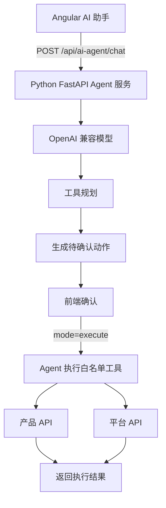
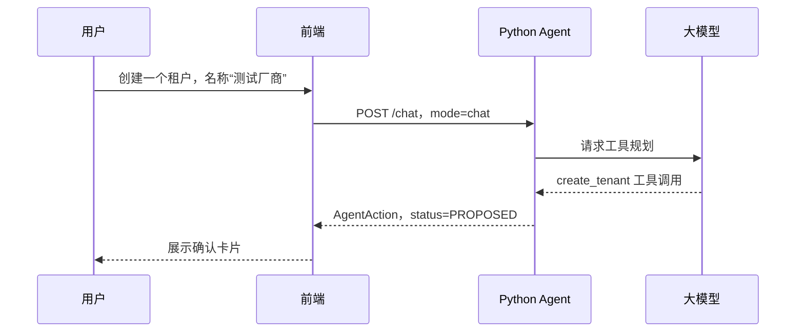
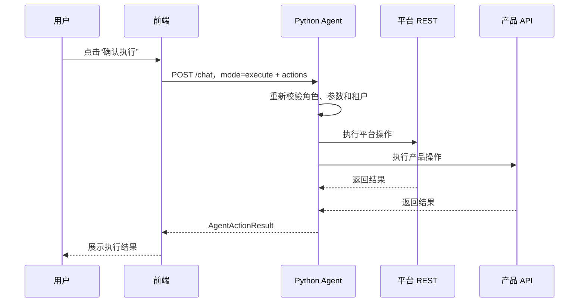

# 11 AI Agent 对话助手方案

> 中国中铁物联网平台文档集｜[总目录](../README.md)｜上一篇 [租户与产品快速使用手册](10-租户与产品快速使用手册.md)｜下一篇 [AI Agent 操作演示](12-AI-Agent操作演示.md)

本文描述前端 AI 对话助手和 Python Agent 后端的实现方案。当前为规划方案，不包含已实现代码。

## 11.1 目标与边界

目标：

- 前端增加全局 AI 对话助手。
- 后端新增一个独立 Python Agent 服务，只暴露一个公开 API。
- 支持系统管理员和租户管理员。
- 支持创建租户、租户管理员、产品、设备、用户。
- 写操作必须由用户确认后执行。

第一版不做：

- 删除、批量修改和批量删除。
- 聊天记录持久化。
- SSE 流式输出。
- 修改平台后端或数据库结构。

## 11.2 总体架构



路径约定：

| 位置 | 路径 |
| --- | --- |
| 浏览器 | `POST /api/ai-agent/chat` |
| Nginx / 开发代理 | `/api/ai-agent/* -> http://ai-agent:8000/*` |
| Python 服务 | `POST /chat` |

Python Agent 是独立服务：

- 不修改平台后端。
- 不直接访问 `thingmodel` 数据库。
- 不读取 `plat_vendor_account`。
- 只调用平台 REST API。

## 11.3 前端设计

新增文件：

```text
ui-ngx/src/app/modules/home/components/ai-agent/
  ai-agent.component.ts
  ai-agent.component.html
  ai-agent.component.scss
ui-ngx/src/app/core/http/ai-agent.service.ts
ui-ngx/src/app/shared/models/ai-agent.models.ts
```

在 `home.component.html` 挂载：

```html
<tb-ai-agent></tb-ai-agent>
```

界面能力：

- 右下角悬浮按钮，仅系统管理员/租户管理员显示。
- 点击打开聊天面板。
- 支持文字输入、JSON 文件上传、历史消息展示。
- 写操作展示待确认动作卡片。
- 动作卡片展示动作类型、目标对象和关键参数。
- 提供“确认执行”和“取消”。
- 确认后再次调用同一个 API，使用 `mode=execute`。
- 聊天记录只保存在前端内存。

前端模型：

```ts
export type AgentMode = 'chat' | 'execute';

export interface AgentMessage {
  role: 'user' | 'assistant';
  content: string;
}

export interface AgentAction {
  id: string;
  type: string;
  summary: string;
  params: Record<string, unknown>;
  status?: 'PROPOSED' | 'EXECUTED' | 'FAILED';
}

export interface AgentChatRequest {
  mode: AgentMode;
  messages: AgentMessage[];
  tsl?: unknown;
  actions?: AgentAction[];
  context?: {
    route?: string;
    productId?: string;
    tenantId?: string;
  };
}

export interface AgentActionResult {
  actionId: string;
  type: string;
  success: boolean;
  message: string;
  data?: Record<string, unknown>;
}

export interface AgentChatResponse {
  reply: string;
  actions: AgentAction[];
  executed: AgentActionResult[];
}
```

## 11.4 Python 后端技术选型

第一版推荐：

```text
Python 3.12
uv
FastAPI
Pydantic
AsyncOpenAI
httpx
pytest + respx
uvicorn
Docker
```

选择理由：

- FastAPI 提供异步 API、Pydantic 校验和 OpenAPI 文档。
- Pydantic 定义工具参数、请求和响应模型，后端重新校验模型输出。
- AsyncOpenAI 支持 OpenAI 兼容接口，可接 DeepSeek、通义千问、Ollama 等。
- httpx 调用平台 REST。
- uv 管理 Python 版本、虚拟环境、依赖和 `uv.lock`。
- 第一版不使用 LangGraph；后续需要多步骤审批、持久化会话、多 Agent 时再迁移。

### REST SDK 选择

平台没有官方维护的管理 REST SDK。`tb-mqtt-client` 和 `tb-gateway-mqtt` 只用于设备侧 MQTT。

| 方案 | 结论 |
| --- | --- |
| `httpx` | 第一版推荐，异步、超时、连接池、类型友好 |
| `requests` | 阻塞式，不适合异步 Agent |
| `aiohttp` | 可用，但更底层，需要自行封装 |
| OpenAPI 生成客户端 | 接口很多时可用，生成代码重，和 TB 版本耦合 |
| 第三方平台 SDK | 不建议，维护和兼容性不确定 |

建议封装 `平台Client`：

```text
AsyncClient
X-Authorization
超时
401 / 429 重试
统一异常转换
业务方法
```

### 服务目录

```text
ai-agent/
  app/
    main.py
    config.py
    auth/
      thingsboard.py
    api/
      agent.py
      health.py
    agent/
      orchestrator.py
      llm.py
      tools.py
      executor.py
      models.py
      prompts.py
    clients/
      thing_model.py
      thingsboard.py
    common/
      errors.py
  tests/
    integration/
  pyproject.toml
  uv.lock
  .python-version
  Dockerfile
```

## 11.5 Agent API

```http
POST /chat
```

- 校验平台 JWT。
- 允许系统管理员和租户管理员。
- 从平台获取当前用户角色和 tenantId。
- 不新增登录体系。

JWT 校验：

```http
GET /api/auth/user
X-Authorization: Bearer <TB_JWT>
```

结果按令牌哈希缓存 60 秒。Python 服务不持久化 JWT，不记录 JWT。

### AgentService

职责：

1. 构建系统提示词和工具定义。
2. 调用 OpenAI 兼容接口。
3. 把模型返回的工具调用转换为待确认动作。
4. 确认后执行白名单工具。
5. 返回自然语言结果和动作结果。

### AgentActionExecutor

只执行白名单动作：

- `create_tenant`
- `create_tenant_admin`
- `create_product`
- `create_device`
- `create_user`

每个动作在服务端重新校验参数、角色和租户范围。

执行层只调用：

- 产品 API
- 平台 REST API

### OpenAI Client

使用 `AsyncOpenAI` 调用 OpenAI 兼容接口：

```text
POST {base-url}/chat/completions
```

要求模型支持 function calling / tools。DeepSeek、通义千问、OpenAI 等兼容接口可直接使用。

## 11.6 平台 REST 对接

| 操作 | REST 接口 | 鉴权 |
| --- | --- | --- |
| 校验当前用户 | `GET /api/auth/user` | 当前用户 JWT |
| 查询租户 | `GET /api/tenants` | 系统管理员 JWT |
| 创建租户 | `POST /api/tenant` | 系统管理员 JWT |
| 初始化厂商服务账号 | `POST /api/admin/tenants/{tenantId}/provision-auto` | 系统管理员 JWT |
| 创建租户管理员 | `POST /api/user?sendActivationMail=true` | 系统管理员 JWT |
| 查询设备 | `GET /api/tenant/devices` | 当前租户 JWT |
| 创建设备 | `POST /api/device` | 租户管理员 JWT |
| 查询产品 | `GET /api/products` | 租户管理员 JWT |
| 创建产品 | `POST /api/products` | 租户管理员 JWT |

Python 调用示例：

```python
import httpx

async def current_user(base_url: str, token: str) -> dict:
    async with httpx.AsyncClient(base_url=base_url, timeout=30) as client:
        response = await client.get(
            "/api/auth/user",
            headers={"X-Authorization": f"Bearer {token}"},
        )
        response.raise_for_status()
        return response.json()
```

调用边界：

- 产品、设备、用户由租户管理员操作本租户。
- 租户、租户管理员、服务账号由系统管理员操作。
- 系统管理员代建产品或设备需要 `thing-model` 额外提供内部管理接口，第一版不做。
- 设备访问令牌不在对话中返回，只返回设备 ID和名称。

## 11.7 Agent 工具与权限

| 工具 | 角色 | 实现 |
| --- | --- | --- |
| `list_tenants` | 系统管理员 | 平台 REST 查询租户 |
| `list_products` | 租户管理员 | `GET /api/products` |
| `list_devices` | 系统管理员/租户管理员 | 平台 REST 查询设备 |
| `create_tenant` | 系统管理员 | 平台 REST，随后初始化平台服务账号 |
| `create_tenant_admin` | 系统管理员 | 平台 REST，角色租户管理员，发送激活邮件 |
| `create_product` | 租户管理员 | `POST /api/products`，由平台自动处理物模型 |
| `create_device` | 租户管理员 | 查询产品配置后创建平台设备 |
| `create_user` | 系统管理员/租户管理员 | 在本租户创建用户并发送激活邮件 |

约束：

- 租户管理员不能指定其他 tenantId。
- Python Agent 不持久化或记录平台 JWT。
- Python Agent 不接触数据库密码和 `THINGMODEL_SECRET_KEY`。
- Python Agent 不直接访问数据库，只调用现有 REST API。
- 第一版不提供删除和修改工具。
- 主键、名称和 TSL 由后端重新校验，不信任模型输出。
- 创建产品由平台自动处理物模型并生成相关资源。
- 创建用户依赖平台 SMTP 激活邮件。
- 设备访问令牌不在对话中返回，只返回设备 ID和名称。

## 11.8 确认流程

第一轮：模型只生成动作，不执行。



第二轮：用户确认后执行。



未确认的写操作不会落库或调用平台。

## 11.9 配置

Python Agent 使用环境变量：

```text
AI_AGENT_ENABLED=true
AI_AGENT_OPENAI_BASE_URL=https://api.deepseek.com/v1
AI_AGENT_OPENAI_API_KEY=<secret>
AI_AGENT_OPENAI_MODEL=deepseek-chat
AI_AGENT_TIMEOUT_SECONDS=60
AI_AGENT_MAX_TOKENS=2048
AI_AGENT_THING_MODEL_URL=http://thing-model:8090
AI_AGENT_THINGSBOARD_URL=http://thingsboard:8080
AI_AGENT_AUTH_CACHE_SECONDS=60
AI_AGENT_MAX_MESSAGES=20
AI_AGENT_MAX_TSL_BYTES=2000000
AI_AGENT_MAX_ACTIONS=10
```

说明：

- `AI_AGENT_OPENAI_API_KEY` 只保存在后端 Secret 中，不返回前端。
- `AI_AGENT_THING_MODEL_URL` 指向产品与物模型模块。
- `AI_AGENT_THINGSBOARD_URL` 指向平台核心服务。
- `AI_AGENT_MAX_MESSAGES` 和 `AI_AGENT_MAX_ACTIONS` 采用队列语义：只保留最近 N 条，超出时静默丢弃最早内容，不返回超限错误。
- Python 服务默认监听 `8000`。

## 11.10 安全要求

- Agent API 必须校验平台 JWT。
- 每个工具独立校验角色和数据范围。
- 所有写操作必须二次确认。
- 消息和动作按队列保留最近 N 条，超出时静默丢弃最早内容；TSL 大小、附件大小和模型输出长度仍需限制。
- AI 调用超时或失败时返回可控错误，不执行动作。
- 工具执行失败不能导致整个对话接口 500。
- 日志记录用户、动作、租户和结果，不记录密码、JWT 和完整敏感参数。
- 第一版只开放创建操作，不开放删除和批量修改。

## 11.11 实施顺序

1. Python Agent 服务骨架、配置和健康检查。
2. 平台 JWT 校验与 `httpx` 客户端封装。
3. OpenAI 兼容模型调用和只读工具。
4. 前端聊天面板和普通对话。
5. 增加 `create_tenant`、`create_tenant_admin`、`create_product`。
6. 增加 `create_device`、`create_user`。
7. 接入确认执行和 JSON 文件上传。
8. 联调和测试。

## 11.12 测试清单

| # | 场景 | 期望 |
| --- | --- | --- |
| 1 | 系统管理员创建租户 | 租户创建成功，服务账号初始化成功 |
| 2 | 系统管理员创建租户管理员 | 用户创建成功并发送激活邮件 |
| 3 | 租户管理员创建本租户产品 | 产品创建并自动生效 |
| 4 | 租户管理员指定其他租户 | 返回 403 |
| 5 | 上传 `4DZDCQUA2D.tencent.json` 创建产品 | 自动规范化 TSL 并创建成功 |
| 6 | 未确认写操作 | 不创建任何数据 |
| 7 | 确认创建动作 | 只执行一次，返回动作结果 |
| 8 | AI 服务不可用 | 返回明确错误，不执行动作 |
| 9 | 创建用户但 SMTP 未配置 | 返回激活邮件失败原因 |
| 10 | 创建设备 | 设备创建成功并绑定产品配置 |

## 11.13 设备侧 MQTT SDK 边界

`tb-mqtt-client` 和 `tb-gateway-mqtt` 只用于设备侧遥测联调：

- `tb-mqtt-client`：设备直连，上报遥测、属性、事件和接收 RPC。
- `tb-gateway-mqtt`：网关代子设备上报。
- 两者使用设备/网关访问令牌，不使用用户 JWT。
- 两者不能创建租户、产品、设备或用户，不属于 Agent 管理 API。

网关场景示例：

```python
from time import time
from tb_gateway_mqtt import TBGatewayMqttClient

gateway = TBGatewayMqttClient(
    "127.0.0.1",
    username="<GATEWAY_ACCESS_TOKEN>"
)
gateway.connect()
gateway.gw_connect_device("Test Device A1")
gateway.gw_send_telemetry(
    "Test Device A1",
    {
        "ts": int(round(time() * 1000)),
        "values": {
            "temperature": 42.2
        }
    }
)
gateway.gw_send_attributes(
    "Test Device A1",
    {
        "firmwareVersion": "2.3.1"
    }
)
gateway.gw_disconnect_device("Test Device A1")
gateway.disconnect()
```

## 11.14 后续扩展

- SSE 流式输出。
- 聊天记录持久化和会话恢复。
- 删除、修改和批量操作。
- 操作审计入库。
- 多轮上下文记忆。
- 语音输入和文件解析。
- LangGraph 多步骤审批和复杂工作流。
