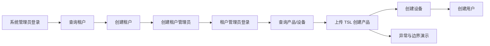

# 12 AI Agent 操作演示

> 中国中铁物联网平台文档集｜[总目录](../README.md)｜上一篇 [AI Agent 对话助手方案](11-AI-Agent对话助手方案.md)

本文用于现场演示前端 AI 助手如何生成待确认动作、确认后执行平台产品和设备操作。

## 12.1 演示目标

演示以下能力：

- 系统管理员查询租户、创建租户、创建租户管理员。
- 租户管理员查询本租户产品/设备、创建产品、创建设备、创建用户。
- 所有写操作先生成待确认动作，用户确认后才执行。
- 产品创建后自动生效。
- 权限、TSL、产品 ID 重复等异常场景有明确结果。

当前不支持通过 AI 删除、修改或批量操作数据。

## 12.2 前置条件

本地演示默认地址：

| 服务 | 地址 |
| --- | --- |
| 平台核心服务 | `http://localhost:18080` |
| 产品与物模型模块 | `http://localhost:8090` |
| ai-agent | `http://localhost:8000` |
| 前端 | `http://localhost:4200` |

本地默认账号：

| 角色 | 账号 |
| --- | --- |
| 系统管理员 | `sysadmin@thingsboard.org` / `sysadmin` |
| 租户管理员 | `tenant@thingsboard.org` / `tenant` |

检查服务：

```bash
curl http://localhost:8000/health
curl http://localhost:8000/ready
curl http://localhost:8090/actuator/health
```

检查配置：

- `ai-agent/.env` 已配置有效的 `AI_AGENT_OPENAI_API_KEY`。
- `AI_AGENT_ENABLED=true`。
- `AI_AGENT_THING_MODEL_URL` 和 `AI_AGENT_THINGSBOARD_URL` 可访问。
- 前端已代理 `/api/ai-agent/` 到 `http://localhost:8000`。

演示物模型：

```text
thing-model/migrate/4DZDCQUA2D.tencent.json
thing-model/migrate/4DZDCQUA2D.tsl.json
```

首次演示可直接使用 `4DZDCQUA2D`。重复演示时建议复制一份 TSL，并把 `profile.ProductId` 改成唯一值，例如 `DEMO2026110301`。

## 12.3 权限与能力

| 能力 | 系统管理员 | 租户管理员 |
| --- | --- | --- |
| 查询租户 | 支持 | 不支持 |
| 创建租户 | 支持 | 不支持 |
| 创建租户管理员 | 支持 | 不支持 |
| 查询本租户产品 | 不支持 | 支持 |
| 查询本租户设备 | 不支持 | 支持 |
| 创建产品 | 不支持 | 支持 |
| 创建设备 | 不支持 | 支持 |
| 创建客户用户 | 支持，需指定 tenantId | 支持，自动使用当前租户 |
| 创建租户管理员 | 支持 | 不支持 |

AI 助手只对系统管理员和租户管理员显示。

## 12.4 演示流程总览



## 12.5 场景 1：打开 AI 助手

1. 使用系统管理员登录平台。
2. 找到右下角 AI 悬浮按钮。
3. 点击按钮打开 AI 助手。
4. 拖动悬浮按钮，刷新页面后确认位置仍然保留。
5. 展示欢迎语和输入框。

预期结果：

- AI 助手面板正常打开。
- 页面切换后历史对话仍然保留。
- 点击“清空对话”后消息和待确认动作被清除。
- 点击“关闭”按钮后面板关闭，悬浮按钮仍可再次打开。

## 12.6 场景 2：查询租户

输入：

```text
查询当前平台租户列表
```

预期结果：

- AI 直接调用只读工具查询租户。
- 不生成待确认动作。
- 回复中展示租户名称、租户 ID等信息。

说明：只读操作不会修改数据，不需要二次确认。

## 12.7 场景 3：创建租户

输入：

```text
创建一个租户，名称是演示厂商，说明是 AI 演示
```

预期结果：

- AI 生成 `create_tenant` 待确认动作。
- 待确认区域显示动作名称和参数。
- 输入框被禁用，提示先确认或取消待确认操作。

点击“取消”：

- 不创建租户。
- 待确认动作消失。

再次输入并点击“确认执行”：

- 创建租户成功。
- 返回租户 ID。
- 平台自动初始化厂商服务账号。
- 如果服务账号初始化失败，返回警告，但租户已经创建。

记录返回的租户 ID，后续创建租户管理员时使用。

## 12.8 场景 4：创建租户管理员

使用上一步返回的租户 ID，输入：

```text
为租户 <tenantId> 创建管理员 demo-admin@example.com
```

预期结果：

- AI 生成 `create_tenant_admin` 待确认动作。
- 确认执行后创建租户管理员用户。
- 如果 SMTP 已配置，用户收到激活邮件。
- 如果 SMTP 未配置，动作返回失败或邮件发送失败原因。

演示提示：

- 不要删除平台自动创建的服务账号。
- 如果收不到激活邮件，可通过平台用户管理页完成激活或重置密码。

## 12.9 场景 5：切换租户管理员查询数据

1. 退出系统管理员。
2. 使用刚创建的租户管理员登录。
3. 打开 AI 助手。

输入：

```text
查询本租户产品
```

再输入：

```text
查询本租户设备
```

预期结果：

- 只返回当前租户的数据。
- 不产生待确认动作。
- 新租户产品和设备为空时，返回空列表或提示暂无数据。

## 12.10 场景 6：创建产品

准备 TSL：

- 点击 AI 面板中的附件按钮上传 `4DZDCQUA2D.tencent.json`。
- 也可以点击 JSON 按钮粘贴 TSL。
- 上传成功后输入框上方显示 TSL 文件名。

输入：

```text
使用当前 TSL 创建产品，产品 ID 为 4DZDCQUA2D，名称是挖掘机物模型，型号 4DZDCQUA2D，分类 1
```

如果使用自定义 产品 ID，先修改 TSL 中的 `profile.ProductId`，再输入对应的产品 ID。

预期结果：

- AI 生成 `create_product` 待确认动作。
- 待确认参数包含产品 ID、名称、型号、分类和 TSL 相关信息。
- 点击“确认执行”后创建产品。
- 平台自动处理物模型并生效。
- 返回产品配置、产品资产和规则链信息。

验证：

1. 打开“产品”页面。
2. 确认产品出现在列表中。
3. 打开产品详情。
4. 确认产品配置、产品资产、规则链已生成。
5. 确认产品已成功保存并生效。

注意事项：

- 产品 ID 全系统唯一，不同租户也不能重复。
- TSL 中的 `profile.ProductId` 必须与请求中的 产品 ID 一致。
- 产品创建动作必须附带 TSL，否则会提示缺少物模型。
- 重复演示前需要更换 产品 ID，或先清理旧产品。

## 12.11 场景 7：创建设备

继续使用租户管理员，确保产品已创建并保存成功。

输入：

```text
为产品 4DZDCQUA2D 创建设备 demo_device_01，名称是演示设备，工点编码 DEMO
```

预期结果：

- AI 生成 `create_device` 待确认动作。
- 确认执行后创建平台设备。
- 设备自动绑定产品配置。
- 设备 `SERVER_SCOPE` 属性写入 `product_id`、`tsl_version` 和 `site_code`。

验证：

1. 打开平台设备列表。
2. 找到 `demo_device_01`。
3. 确认产品配置正确。
4. 查看服务端属性，确认产品 ID、TSL 版本和工点编码正确。

设备名称限制：

- 只能包含英文、数字和下划线。
- 最长 48 个字符。
- 不返回设备访问令牌。

## 12.12 场景 8：创建用户

输入：

```text
创建用户 demo-user@example.com，角色客户用户
```

预期结果：

- AI 生成 `create_user` 待确认动作。
- 确认执行后创建用户。
- 如果 SMTP 已配置，用户收到激活邮件。
- 客户用户只能访问被授权的内容。

如果使用系统管理员创建用户，必须提供租户 ID：

```text
为租户 <tenantId> 创建用户 demo-user@example.com，角色客户用户
```

说明：

- 租户管理员可以创建客户用户。
- 租户管理员不能创建租户管理员。
- 系统管理员可以创建租户管理员或客户用户，但必须指定租户。

## 12.13 场景 9：异常与边界

### 12.13.1 取消待确认动作

生成动作后点击“取消”。

预期结果：

- 不调用平台后端。
- 不产生任何数据。
- 可以继续输入新的需求。

### 12.13.2 越权操作

使用租户管理员输入：

```text
查询所有平台租户
```

预期结果：

- 返回权限不足。
- 不返回其他租户数据。

### 12.13.3 缺少 TSL 创建产品

不附加 TSL，直接输入：

```text
创建产品，产品 ID 为 DEMO0001，名称是演示产品
```

预期结果：

- AI 提示需要先上传或粘贴 TSL。
- 不生成可执行的产品创建动作。

### 12.13.4 产品 ID 重复

使用已经存在的 产品 ID 创建产品。

预期结果：

- 返回 产品 ID 冲突。
- 提示 产品 ID 必须全系统唯一。
- 不创建重复产品。

### 12.13.5 消息和动作超限

连续发送超过 20 条消息，或生成超过 10 个动作。

预期结果：

- 不显示超限错误。
- 后端只保留最近 20 条消息和最近 10 个动作。
- 最早的消息和动作被静默丢弃。

### 12.13.6 AI 服务不可用

停止 ai-agent 或填写错误的 OpenAI Key。

预期结果：

- 前端显示操作失败。
- 不执行任何写操作。
- 待确认动作不会被创建。

## 12.14 演示检查清单

| 检查项 | 期望 |
| --- | --- |
| 查询租户 | 直接返回结果，无待确认动作 |
| 创建租户 | 确认后创建成功，服务账号自动初始化 |
| 创建租户管理员 | 确认后创建用户，触发激活邮件 |
| 查询产品/设备 | 只返回当前租户数据 |
| 创建产品 | TSL 校验通过，自动生效 |
| 创建设备 | 绑定正确产品配置和产品属性 |
| 创建用户 | 角色正确，触发激活邮件 |
| 取消动作 | 不产生数据 |
| 越权操作 | 返回权限错误 |
| 产品 ID 重复 | 返回全系统唯一冲突 |
| 消息/动作超限 | 静默丢弃最早内容，不报错 |
| AI 服务不可用 | 返回失败提示，不执行动作 |

## 12.15 清理与重置

AI 助手当前不提供删除操作。演示结束后按以下方式清理：

1. 在产品页面删除演示产品。
2. 在平台设备页面删除演示设备。
3. 在平台用户页面删除演示用户。
4. 在平台租户页面删除演示租户。
5. 点击 AI 助手“清空对话”清除本地聊天记录。

注意事项：

- 删除产品前先删除该产品下的设备。
- 删除租户前先确认租户下没有保留的数据。
- 每次演示建议使用唯一 产品 ID，避免全系统唯一约束冲突。
- 演示前不要提交真实 API 密钥、JWT、密码或数据库密钥。
