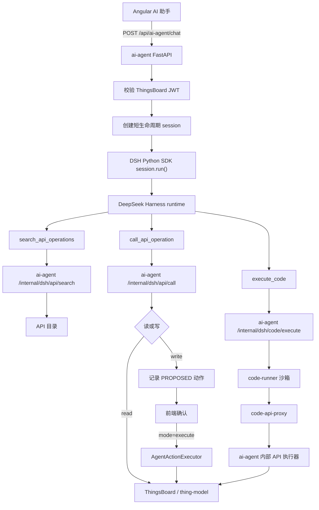

# 13 AI Agent DSH 全接口接入方案

> 中国中铁物联网平台文档集｜[总目录](../README.md)｜上一篇 [AI Agent 操作演示](12-AI-Agent操作演示.md)

本文描述如何用 DeepSeek Harness（`dsh`）替换 `ai-agent` 当前的编排层，并用统一的 API 目录接入 ThingsBoard 与 thing-model 的全部 OpenAPI 接口。

本文为规划方案，不包含已实现代码。

## 13.1 背景与目标

当前 `ai-agent` 通过 `AsyncOpenAI` 兼容接口调用 DeepSeek，并在 `app/agent/orchestrator.py` 中自行实现“模型规划 + 工具循环”。现有工具固定为 8 个：

- 只读：`list_tenants`、`list_products`、`list_devices`
- 写操作：`create_tenant`、`create_tenant_admin`、`create_product`、`create_device`、`create_user`

这种实现有两个限制：

- 新增一个平台接口就要新增一套工具定义、参数模型、执行逻辑和测试。
- 无法低成本覆盖 ThingsBoard 与 thing-model 的其余 REST API。

目标：

- 用 DSH 替换 `orchestrator.py` 中的模型规划循环。
- 保持前端 `POST /chat` 协议不变。
- 用“一份 API 目录 + 一个通用执行器”接入 ThingsBoard 和 thing-model 的全部 OpenAPI 接口。
- 新增接口时只更新目录，不修改 DSH 插件代码。
- 写操作仍然只生成 `PROPOSED` 动作，用户确认后才执行。
- ThingsBoard JWT 不进入 DSH 进程，也不暴露给模型。

## 13.2 已确认的设计决策

| 决策 | 结论 |
| --- | --- |
| 启用策略 | 读写接口同时开放；普通写接口只生成待确认动作 |
| DSH 工具形态 | 只保留 `search_api_operations`、`call_api_operation`、`execute_code` 三个工具 |
| 目录维护 | OpenAPI 自动导入 + 人工审核，`overrides.yaml` 保留人工配置 |
| 写操作执行 | 普通写操作由 `AgentActionExecutor` 执行；代码写操作走执行级确认 |
| 高危接口 | `DELETE`、批量、管理员接口默认启用，但标记 `risk: high`，展示高危提示并记录审计 |
| 代码能力 | 支持生成和沙箱执行；只读代码立即执行，含写操作代码走执行级确认 |
| 沙箱网络 | 只能访问 `code-api-proxy`，不能访问互联网，不能直连两个业务服务 |
| 沙箱写操作 | 用户确认代码和 `allowed_operations` 后执行，未列出的写操作一律拒绝 |
| 沙箱鉴权 | 使用短期 `execution_token`，不向沙箱注入 ThingsBoard JWT |
| 回滚方式 | 保留原 OpenAI 编排路径，通过 `AI_AGENT_ENGINE=openai` 回滚 |

## 13.3 总体架构



核心边界：

- `ai-agent` 负责鉴权、会话上下文、权限校验、工具执行和动作确认。
- DSH 负责模型规划、工具选择和对话生成。
- DSH 只拿到不可猜测的 `session_id`，不接触 ThingsBoard JWT。
- 模型只传 `operation_id` 和参数，不能传 URL、HTTP 方法或后端地址。
- 代码执行只进入 `code-runner` 沙箱；沙箱不能直连 ThingsBoard、thing-model 或互联网。
- 沙箱通过 `code-api-proxy` 访问两个业务服务；proxy 只放行 `execution_token` 授权的操作。
- 代码写操作必须先经过执行级确认；未确认的代码不会运行。

## 13.4 DSH 接入方式

### 13.4.1 技术选型

DeepSeek Harness 是 DeepSeek AI 开源的 agent harness，基于 TypeScript、Cordis 和“everything is a plugin”架构。

集成使用官方 Python SDK：

```text
deepseek-harness-sdk
```

该 SDK 会启动随包分发的 `dsh` runtime：

```text
dsh --profile thingsboard
```

推荐构建专用 profile `thingsboard`，以 `sdk-minimal` 为参考基座，但只保留：

- SDK JSON-RPC server
- DeepSeek adapter
- thingsboard-api 插件
- sandbox-code 插件

必须移除或禁用 `bash`、`pwsh`、`read_image`、`working_directory` 以及所有文件读写工具。不得直接使用 `sdk-minimal` 默认的持久 shell。

注意：

- DSH 目前是 developer preview，存在兼容性变更。
- 必须固定 `deepseek-harness-sdk` 和 runtime 版本。
- 升级前必须运行工具契约测试和端到端回归。
- 专用 profile 和插件用 `ctx.tools.restrict` 双重限制模型可见工具，只保留三个通用工具。

### 13.4.2 Python 侧配置

在 `ai-agent/pyproject.toml` 增加并固定版本：

```toml
dependencies = [
  # ...
  "deepseek-harness-sdk==0.2.1rc2",
]
```

`ai-agent` 启动时创建一个复用的 DSH runtime 实例：

```python
from deepseek_harness import DeepSeekHarness

harness = DeepSeekHarness(
    dsh_home=settings.dsh_home,
    cwd=settings.dsh_workspace,
    profile=settings.dsh_profile,
    patches=(settings.dsh_patch_file,),
    provider=settings.dsh_provider,
    model=settings.dsh_model,
    api_key=settings.deepseek_api_key,
    base_url=settings.deepseek_base_url,
    max_tokens=settings.max_tokens,
)
```

要求：

- `dsh_home` 必须是显式路径，不能依赖 `~/.dsh`。
- `cwd` 使用独立空目录，不挂载业务代码。
- DSH runtime 与 `ai-agent` 同 Pod 运行，由 `ai-agent` 管理生命周期。
- DSH 进程退出、超时或初始化失败时，返回统一的 `AgentUnavailable`。

### 13.4.3 DSH profile 与工具限制

使用专用 `thingsboard` profile 加一个 patch，挂载 `thingsboard` 插件：

```yaml
- insert:
    - id: thingsboard-api
      name: '@iot/dsh-plugin-thingsboard'
```

插件在 `apply(ctx)` 中：

1. 注册 `search_api_operations`、`call_api_operation`、`execute_code`。
2. 调用 `ctx.tools.restrict({ allow: ['search_api_operations', 'call_api_operation', 'execute_code'] })`，隐藏 shell、文件、图片等内置工具。
3. 不在插件中保存 JWT 或业务密钥。
4. `execute_code` 只调用 `ai-agent` 内部执行接口，不在 DSH 进程内直接运行代码。

上线前必须验证：

- 模型看不到 `bash`、`pwsh`、`read_image`、`working_directory` 等工具。
- 模型只能调用三个通用工具。
- `exec.agent.id` 与 `ai-agent` 传入的 `session_id` 一致。
- `execute_code` 无法在 DSH 进程内执行任意命令。

### 13.4.4 代码执行入口

DSH 的 `execute_code` 工具只负责把请求转给 `ai-agent`，真正的代码执行在独立 `code-runner` 中完成：

```text
DSH execute_code
  -> ai-agent /internal/dsh/code/execute
  -> 校验 session、权限、代码大小、allowed_operations、risk
  -> read：立即执行
  -> write：返回 PROPOSED 动作，等待用户确认
```

`execute_code` 参数：

```json
{
  "language": "python",
  "code": "...",
  "stdin": "...",
  "access": "read",
  "allowed_operations": [],
  "justification": ""
}
```

- `access: read`：只能调用 `code_access: read` 的读接口。
- `access: write`：必须列出 `allowed_operations`，并且走执行级确认。
- 不允许代码直接访问 host、文件系统、互联网或 ThingsBoard JWT。

### 13.4.5 系统提示词

通过 `DSH_SYSTEM_PROMPT` 设置基础提示词，核心约束包括：

- 当前角色是物联网平台管理助手。
- 任何 ThingsBoard 或 thing-model 操作必须先调用 `search_api_operations`。
- 找到 `operation_id` 后再调用 `call_api_operation`。
- 不得编造 `operation_id`。
- 不得尝试访问目录之外的接口。
- 写操作只生成待确认动作，不声称已经执行。
- 代码执行只能通过 `execute_code`，不能尝试使用 shell、文件或网络工具。
- 只读代码可以直接执行；包含写操作的代码必须声明 `access: write` 和完整的 `allowed_operations`。
- 不在代码中硬编码 JWT、密码、API Key 或内部地址。
- 不输出 JWT、密码、API Key、完整 TSL。

每次请求的 `authority`、`tenant_id`、是否有 TSL 作为 `[运行上下文]` 写入输入，避免 DSH 进程级环境变量无法按请求变化。

### 13.4.6 对话历史

当前前端每次请求都发送完整 `messages`。第一版采用无状态方式：

- 每次请求生成新的 DSH `session_id`。
- 将最近 `AI_AGENT_MAX_MESSAGES` 条消息格式化为结构化上下文，作为 `session.run()` 输入。
- 运行结束后清理 DSH session，避免长期累积。

后续如果前端增加稳定的 `conversation_id`，可以改为复用 DSH 持久会话，减少重复上下文。

## 13.5 API 目录

### 13.5.1 目录文件

```text
ai-agent/
└── config/
    └── api/
        ├── thingsboard.yaml
        ├── thing_model.yaml
        └── overrides.yaml
```

- `thingsboard.yaml`：由 ThingsBoard OpenAPI 自动生成。
- `thing_model.yaml`：由 thing-model OpenAPI 自动生成。
- `overrides.yaml`：人工维护的中文摘要、别名、权限、风险和 handler 配置。

### 13.5.2 目录项结构

```yaml
- id: thingsboard.listTenants
  service: thingsboard
  method: GET
  path: /api/tenants
  summary: 查询租户列表
  aliases: [租户, 厂商, tenant]
  tags: [tenant]
  mode: read
  code_access: read
  permission: SYS_ADMIN
  risk: low
  enabled: true
  params:
    pageSize:
      in: query
      type: integer
      default: 100
    page:
      in: query
      type: integer
      default: 0

- id: thing_model.updateThingModel
  service: thing_model
  method: PUT
  path: /api/products/{productId}/thing-model
  summary: 更新物模型
  aliases: [物模型, TSL, 更新产品]
  tags: [product, tsl]
  mode: write
  code_access: write
  permission: TENANT_ADMIN
  risk: medium
  enabled: true
  handler: update_thing_model
  params:
    productId:
      in: path
      type: string
      required: true
```

字段说明：

| 字段 | 必填 | 说明 |
| --- | --- | --- |
| `id` | 是 | 稳定唯一 ID，建议 `service.operationId` |
| `service` | 是 | `thingsboard` 或 `thing_model` |
| `method` | 是 | `GET`、`POST`、`PUT`、`PATCH`、`DELETE` |
| `path` | 是 | 以 `/` 开头的相对路径，不含 host |
| `summary` | 是 | 模型和前端看到的简短说明 |
| `aliases` | 否 | 搜索别名，支持中文 |
| `tags` | 否 | 搜索和分组标签 |
| `mode` | 是 | `read` 立即执行；`write` 生成待确认动作 |
| `permission` | 是 | `ANY`、`TENANT_ADMIN`、`SYS_ADMIN` |
| `risk` | 是 | `low`、`medium`、`high` |
| `enabled` | 是 | 是否允许模型调用 |
| `handler` | 否 | 复杂业务使用自定义处理函数 |
| `params` | 否 | 参数映射和校验规则 |

### 13.5.3 参数映射

参数来源：

- `path`：替换 URL 模板。
- `query`：查询字符串。
- `body`：JSON 请求体。
- `header`：仅允许白名单请求头，默认不使用。

规则：

- `path` 参数必须 `required: true`。
- `body` 参数使用 JSON Schema 子集校验。
- 不允许模型传 `Authorization`、`X-Authorization`、`Cookie`。
- 列表接口默认分页，避免一次返回过多数据。
- 响应体超过 `AI_AGENT_API_MAX_RESPONSE_BYTES` 时截断，并提示模型缩小查询范围。
- 完整 TSL 不进入模型上下文；需要 TSL 的接口使用 `handler`。

## 13.6 DSH 侧工具

DSH 插件只注册三个工具。

### 13.6.1 `search_api_operations`

请求：

```json
{
  "query": "查询租户",
  "service": "thingsboard",
  "limit": 5
}
```

返回：

```json
[
  {
    "id": "thingsboard.listTenants",
    "summary": "查询租户列表",
    "mode": "read",
    "risk": "low",
    "params": {
      "pageSize": {"type": "integer"},
      "page": {"type": "integer"}
    }
  }
]
```

行为：

- 在 `id`、`summary`、`aliases`、`tags` 中搜索。
- 支持中文、英文和拼音别名。
- 只返回 `enabled: true` 的操作。
- 默认返回 5 条，最多 10 条。
- 返回紧凑参数 schema，避免占用过多上下文。

### 13.6.2 `call_api_operation`

请求：

```json
{
  "operation_id": "thingsboard.listTenants",
  "params": {
    "pageSize": 100,
    "page": 0
  }
}
```

只读返回：

```json
{
  "status": "OK",
  "data": []
}
```

写操作返回：

```json
{
  "status": "PROPOSED",
  "action_id": "call_xxx",
  "operation_id": "thingsboard.createTenant",
  "summary": "创建租户",
  "risk": "low"
}
```

错误返回：

```json
{
  "status": "ERROR",
  "code": "OPERATION_NOT_FOUND",
  "message": "未找到或未启用该接口"
}
```

行为：

- 校验 `operation_id` 是否存在且已启用。
- 校验参数类型、必填项和枚举值。
- 校验用户权限和租户边界。
- 读操作立即调用后端。
- 写操作只创建 `AgentAction`，不调用后端。
- 所有错误都返回结构化 JSON，不抛异常给模型。

### 13.6.3 `execute_code`

只读代码请求：

```json
{
  "language": "python",
  "code": "print('hello')",
  "stdin": "",
  "access": "read",
  "allowed_operations": []
}
```

写代码请求：

```json
{
  "language": "python",
  "code": "...",
  "stdin": "...",
  "access": "write",
  "allowed_operations": [
    "thingsboard.createTenant",
    "thingsboard.createUser"
  ],
  "justification": "批量创建测试租户和用户"
}
```

只读代码返回：

```json
{
  "status": "OK",
  "stdout": "hello\n",
  "stderr": "",
  "exit_code": 0,
  "truncated": false
}
```

写代码返回待确认动作：

```json
{
  "status": "PROPOSED",
  "action_id": "call_xxx",
  "operation_id": "execute_code",
  "summary": "执行代码并调用 2 个写接口",
  "risk": "medium"
}
```

行为：

- `access: read`：立即执行，`execution_token` 只允许读。
- `access: write`：生成 `AgentAction`，用户确认后才执行。
- `allowed_operations` 必须是目录中 `code_access: write` 的写操作。
- 代码只能通过 `code-api-proxy` 访问两个业务服务，不能访问互联网或宿主机文件。
- 代码中未列出的写操作由 proxy 拒绝。
- 执行结束后吊销 `execution_token`。

## 13.7 ai-agent 侧组件

| 文件 | 职责 |
| --- | --- |
| `app/agent/api_catalog.py` | 加载目录、搜索、按 ID 查找、参数 schema |
| `app/agent/api_executor.py` | 通用 HTTP 执行、鉴权、超时、响应截断 |
| `app/agent/tool_gateway.py` | 读执行、写提案、会话上下文校验 |
| `app/api/internal.py` | `/internal/dsh/api/*`、`/internal/dsh/code/*` |
| `app/agent/dsh.py` | DSH SDK 生命周期、`session.run()`、错误映射 |
| `app/agent/sessions.py` | `session_id -> token/user/tsl/proposals` 短 TTL 存储 |
| `app/agent/executor.py` | 自定义 handler 与 catalog 通用写执行 |
| `app/agent/code_execution.py` | `execution_token`、代码执行级确认、写操作白名单 |
| `app/clients/code_runner.py` | 调用 `code-runner` HTTP 接口 |
| `app/clients/code_proxy.py` | 调用 `code-api-proxy` 的鉴权与执行接口 |
| `scripts/import_openapi.py` | OpenAPI 导入、合并 overrides、生成 diff |
| `code-runner/` | 独立沙箱服务，使用 gVisor/Firecracker/nsjail |
| `code-api-proxy/` | 只允许两个业务服务的鉴权代理 |
| `dsh-plugin-thingsboard/` | DSH TypeScript 插件，只注册三个工具 |

### 13.7.1 会话存储

每次 `POST /chat`：

1. 生成 `session_id = uuid4().hex`。
2. 保存 `token`、`CurrentUser`、`tsl`、`proposals`。
3. TTL 设置为 DSH 超时时间加 30 秒。
4. DSH 工具回调时用 `exec.agent.id` 查找上下文。
5. 请求结束后读取并清空 proposals，然后删除会话。

约束：

- JWT 只保存在内存中，不写入磁盘、不写日志。
- session_id 必须不可猜测。
- 并发请求使用独立 session，不共享可变状态。
- 同一 session 的 proposals 使用锁保护。

### 13.7.2 内部接口

```text
POST /internal/dsh/api/search
POST /internal/dsh/api/call
```

要求：

- 仅监听集群内部地址，不经过 Ingress。
- 使用 `AI_AGENT_INTERNAL_TOOL_TOKEN` 共享密钥。
- 校验 `X-Internal-Token`。
- 只接受 DSH runtime 所在 Pod 的访问。
- 不返回 JWT、密码、API Key、完整 TSL。

### 13.7.3 写操作执行

`call_api_operation` 对写接口只生成：

```python
AgentAction(
    id="call_xxx",
    type="thingsboard.createTenant",
    summary="创建租户",
    params={"title": "测试厂商"},
    status="PROPOSED",
)
```

建议扩展 `AgentAction` 可选字段：

```python
risk: Literal["low", "medium", "high"] = "low"
```

前端可以展示高危标识；旧客户端忽略该字段即可。

`mode=execute` 时：

1. 按 `action.type` 查找目录项。
2. 有 `handler`：调用现有自定义逻辑。
3. 无 `handler`：调用 `ApiExecutor` 通用执行。
4. 重新校验参数、权限、租户和 `enabled` 状态。
5. 返回 `AgentActionResult`，协议保持不变。

### 13.7.4 代码执行级确认

`execute_code` 分两种模式：

| 模式 | 行为 |
| --- | --- |
| `access: read` | 立即执行，`execution_token` 只允许 `code_access: read` 操作 |
| `access: write` | 先生成 `AgentAction(type=execute_code, status=PROPOSED)`，用户确认后执行 |

写代码动作：

```python
AgentAction(
    id="call_xxx",
    type="execute_code",
    summary="执行代码并调用 2 个写接口",
    params={
        "language": "python",
        "code": "...",
        "stdin": "...",
        "access": "write",
        "allowed_operations": [
            "thingsboard.createTenant",
            "thingsboard.createUser",
        ],
        "justification": "批量创建测试租户和用户",
    },
    status="PROPOSED",
    risk="medium",
)
```

前端确认页必须展示：

- 完整代码，支持折叠和语法高亮。
- 语言和超时时间。
- `allowed_operations` 列表。
- 最高风险等级。
- 写操作数量上限。
- “确认执行”和“取消”。

用户确认后，`mode=execute` 才会启动沙箱。代码参数在执行前由服务端重新校验，不能信任前端回传的代码或操作列表。

### 13.7.5 code-runner 沙箱

`code-runner` 是独立服务，负责运行不可信代码。它不持有 ThingsBoard JWT，也不直接访问两个业务服务。

接口：

```text
POST /execute
{
  "language": "python",
  "code": "...",
  "stdin": "...",
  "execution_token": "...",
  "timeout_seconds": 30
}
```

返回：

```json
{
  "stdout": "...",
  "stderr": "",
  "exit_code": 0,
  "truncated": false,
  "operations": []
}
```

运行约束：

- 使用 gVisor、Firecracker 或 nsjail。
- 非 root。
- 只读根文件系统。
- 一次性 tmpfs 工作目录。
- 不挂载宿主目录、Docker socket、K8s ServiceAccount Token。
- 不注入 JWT、API Key、数据库密码。
- seccomp + AppArmor。
- CPU、内存、进程数、运行时间、输出大小限制。
- 固定 Python/Node 运行时，不包含包管理器。
- 代码只能通过 `stdin` 接收数据，通过 `stdout` / `stderr` 返回结果。
- 代码可以在 tmpfs 中写临时文件，执行结束立即销毁。
- 不允许代码直接访问互联网或 ThingsBoard / thing-model。

### 13.7.6 code-api-proxy

`code-api-proxy` 是沙箱访问两个业务服务的唯一入口。

网络链路：

```text
code-runner -> code-api-proxy -> ai-agent -> ThingsBoard / thing-model
```

proxy 职责：

- 校验 `execution_token` 签名、有效期、执行状态和 session。
- 只允许访问：
  - `/thingsboard/**`
  - `/thing_model/**`
- 不接受任意 host、绝对 URL 或 IP 直连。
- 读操作：只允许 `code_access: read` 或 `write`。
- 写操作：
  - token 必须为 `mode=write`；
  - operation 必须在 `allowed_operations` 中；
  - 目录项必须为 `code_access: write`；
  - 写操作次数不能超过 `max_write_operations`。
- 拒绝 `/api/auth/**`、Token、密码、管理员控制台等敏感接口。
- 校验参数 schema、参数长度、请求方法和路径。
- 响应大小限制和字段脱敏。
- 记录审计：execution_id、session_id、user、operation、耗时、响应大小。
- 不持有 ThingsBoard JWT；实际业务调用由 `ai-agent` 完成。

### 13.7.7 execution_token

`execution_token` 由 `ai-agent` 在执行前签发：

```json
{
  "execution_id": "exec_xxx",
  "session_id": "sess_xxx",
  "user_id": "...",
  "mode": "read",
  "allowed_operations": [],
  "max_requests": 50,
  "max_write_operations": 10,
  "expires_at": 1234567890,
  "jti": "..."
}
```

规则：

- 256 位随机值或 Ed25519/HMAC 签名令牌。
- TTL 等于代码执行超时加 10 秒。
- 写模式必须列出 `allowed_operations`。
- 执行结束后立即吊销。
- 多副本部署使用 Redis 保存 `jti` 使用状态和吊销标记。
- 单副本可先用内存存储，重启即失效。
- token 不包含 ThingsBoard JWT。

## 13.8 OpenAPI 自动导入

### 13.8.1 数据来源

ThingsBoard：

- 运行时：`GET /v3/api-docs/thingsboard`
- 构建产物：`application/target/openapi.json`

thing-model：

- 运行时：`GET /v3/api-docs`
- 路径前缀：`/api/products`、`/api/admin`、`/api/auth`

两个服务都使用 ThingsBoard JWT，请求头为：

```http
X-Authorization: Bearer <TB_JWT>
```

### 13.8.2 导入流程

```text
scripts/import_openapi.py
  -> 读取 OpenAPI JSON
  -> 解析 paths / methods / operationId / tags / parameters / requestBody
  -> 生成目录项
  -> 合并 overrides.yaml
  -> 输出 YAML 和 diff
  -> 人工审核
  -> 提交
```

命令示例：

```bash
python scripts/import_openapi.py \
  --service thingsboard \
  --spec application/target/openapi.json \
  --out config/api/thingsboard.yaml \
  --overrides config/api/overrides.yaml

python scripts/import_openapi.py \
  --service thing_model \
  --spec http://localhost:8090/v3/api-docs \
  --out config/api/thing_model.yaml \
  --overrides config/api/overrides.yaml
```

### 13.8.3 默认转换规则

| OpenAPI 元素 | 目录字段 |
| --- | --- |
| `operationId` | `id = service.operationId` |
| `summary` | `summary`，可被 overrides 覆盖 |
| `tags` | `tags` |
| `GET` | `mode: read` |
| `POST/PUT/PATCH/DELETE` | `mode: write` |
| `DELETE`、批量、管理员路径 | `risk: high` |
| 其他写操作 | `risk: medium` |
| 查询类操作 | `risk: low` |
| path 参数 | `in: path`、`required: true` |
| query 参数 | `in: query` |
| requestBody | `in: body` |
| 所有导入项 | 默认 `enabled: true` |

### 13.8.4 排除规则

默认排除：

- `/api/auth/**`、`/api/noauth/**`
- 登录、刷新 Token、密码重置
- multipart、文件上传、二进制响应
- WebSocket、SSE、长连接、流式接口
- 内部调试、管理控制台和 Actuator 接口
- 需要客户端证书或非 TB JWT 的接口

被排除的接口不会进入目录；如果确实需要，手工在 overrides 中补充。

### 13.8.5 overrides 合并规则

`overrides.yaml` 以 `id` 为键：

```yaml
thingsboard.listTenants:
  summary: 查询租户列表
  aliases: [租户, 厂商, tenant]
  permission: SYS_ADMIN
  risk: low

thing_model.updateThingModel:
  summary: 更新物模型
  aliases: [物模型, TSL, 更新产品]
  permission: TENANT_ADMIN
  handler: update_thing_model
```

合并规则：

- 自动生成字段可以被覆盖。
- `enabled`、`permission`、`risk`、`handler`、`aliases` 始终以 overrides 为准。
- 自动导入不得删除人工新增的目录项。
- 删除接口时先生成 diff，人工确认后再删除。

### 13.8.6 CI 校验

增加测试或 CI 步骤：

```bash
python scripts/import_openapi.py --check
```

检查：

- 目录 YAML 格式合法。
- `id` 唯一。
- `service`、`method`、`path`、`mode`、`permission`、`risk` 合法。
- OpenAPI 变更后目录未过期。
- overrides 中的 `handler` 存在。
- 所有 `enabled: true` 的操作都有有效参数定义。

## 13.9 权限与安全

### 13.9.1 权限模型

| 权限 | 允许操作 |
| --- | --- |
| `ANY` | 当前登录用户可执行的公共查询 |
| `TENANT_ADMIN` | 租户管理员可执行的本租户操作 |
| `SYS_ADMIN` | 系统管理员可执行的管理操作 |

规则：

- `TENANT_ADMIN` 不能调用 `SYS_ADMIN` 接口。
- 带 `tenantId` 的路径或请求体必须与 JWT 所属租户一致。
- `SYS_ADMIN` 创建租户、租户管理员等操作保留现有校验。
- 所有通用写操作在执行前再次校验，不能只依赖提案时的校验。

### 13.9.2 安全约束

- 模型不能指定 host、base URL、HTTP 方法。
- 只允许目录中 `enabled: true` 的操作。
- 默认只允许 `https` 或集群内部地址。
- 禁止访问元数据服务、localhost 管理端口和文件路径。
- 请求体、响应体大小限制。
- 响应中的密码、Token、密钥字段自动脱敏。
- 不把完整 TSL 回传给模型。
- 内部接口使用共享密钥，仅本机可达。
- DSH 进程、code-runner、code-api-proxy 都不持有 ThingsBoard JWT。
- 沙箱不能访问互联网、宿主机文件、K8s API 和云元数据。
- 代码写操作必须经过执行级确认，未列出的写操作一律拒绝。
- 所有写操作记录审计日志：
  - `session_id`
  - `user_id`
  - `operation_id`
  - `execution_id`
  - `risk`
  - `success`
  - `duration_ms`
  - `write_count`
- 代码执行额外记录：
  - 代码哈希
  - 语言
  - 输入/输出大小
  - 实际调用的 operation 列表
  - `exit_code`

### 13.9.3 高危接口

按当前决策，高危接口默认启用，但：

- `risk: high` 写入目录和 `AgentAction`。
- 前端动作卡片展示“高危操作”标识。
- `summary` 中明确说明影响范围。
- 执行前仍需要用户确认。
- 批量、删除、管理员接口建议增加二次确认文案。
- 审计日志单独标记。

如果后续要求高危接口默认关闭，只需调整导入脚本，把 `DELETE`、批量和管理员接口的 `enabled` 设为 `false`。

### 13.9.4 沙箱鉴权

沙箱鉴权遵循“三级隔离”：

```text
DSH 进程：只有 session_id，没有 JWT
code-runner：只有 execution_token，没有 JWT
code-api-proxy：只有 execution_token 和内部服务凭据，没有 JWT
ai-agent：持有 JWT，负责最终业务调用
```

`execution_token` 必须：

- 短期有效，默认 40 秒。
- 绑定 `execution_id`、`session_id`、`user_id`。
- 绑定 `mode` 和 `allowed_operations`。
- 限制 `max_requests` 和 `max_write_operations`。
- 使用 `jti` 防重放。
- 执行结束立即吊销。
- 不包含 ThingsBoard JWT、密码或 API Key。

### 13.9.5 网络策略

默认拒绝所有流量，再按需放行：

| 来源 | 目标 | 端口 | 说明 |
| --- | --- | --- | --- |
| `code-runner` | `code-api-proxy` | 8443 | 唯一出口 |
| `code-runner` | `kube-dns` | 53 | 仅解析 proxy |
| `code-api-proxy` | `ai-agent` | 8000 | 只调用内部执行接口 |
| `ai-agent` | ThingsBoard | 8080 | 业务调用 |
| `ai-agent` | thing-model | 8090 | 业务调用 |
| 前端网关 | `ai-agent` | 8000 | 公开 `/chat` |

禁止：

- `code-runner` 访问互联网。
- `code-runner` 直连 ThingsBoard / thing-model。
- `code-runner` 访问 K8s API、云元数据、其他命名空间。
- `code-api-proxy` 访问互联网。
- ThingsBoard / thing-model 接受来自 `code-runner` 或 proxy 的直接访问。

### 13.9.6 代码读写边界

| 目录字段 | 只读代码 | 写代码 |
| --- | --- | --- |
| `code_access: read` | 允许 | 允许 |
| `code_access: write` | 拒绝 | 仅允许 `allowed_operations` 中的操作 |
| `code_access: none` | 拒绝 | 拒绝 |

规则：

- 只读代码不能调用任何写接口。
- 写代码必须显式列出 `allowed_operations`。
- 未列出的写操作由 proxy 拒绝，ai-agent 再拒绝一次。
- 代码写操作不走单动作 `PROPOSED`，而是走代码执行级确认。
- 用户确认页必须展示代码和写操作列表。
- 高危写操作在确认页单独标识。
- 代码执行结果包含实际调用的 operation 列表，便于审计。

### 13.9.7 数据外泄控制

- 沙箱不能访问互联网。
- 沙箱不能直连两个业务服务。
- 代码只能通过 proxy 访问目录中允许的接口。
- proxy 不接受任意 host、绝对 URL、IP 直连。
- 写代码的 `allowed_operations` 由用户在确认页审核。
- 代码输入、输出大小限制。
- 响应字段脱敏，过滤 token、password、secret、authorization。
- 审计记录代码哈希、输入大小、输出大小、实际调用操作。
- 不把完整 TSL、JWT、密码传入沙箱。

## 13.10 测试

### 13.10.1 目录与导入

- YAML 加载、字段校验、ID 唯一性。
- OpenAPI fixture → 目录 golden 文件。
- overrides 合并正确。
- `--check` 能发现目录过期。
- 排除规则正确。

### 13.10.2 搜索与调用

- 中文、英文、别名、tag 搜索。
- 分页和 `limit` 上限。
- 未知 operation、未启用 operation 拒绝。
- 参数类型、必填项、枚举校验。
- 响应大小截断。

### 13.10.3 读操作

- 使用 `respx` mock ThingsBoard / thing-model。
- 路径参数、查询参数、body 正确组装。
- 鉴权头正确。
- 超时和 4xx/5xx 错误映射。
- 租户越权拒绝。

### 13.10.4 写操作

- `call_api_operation` 只生成 `PROPOSED`，不发送后端请求。
- `AgentAction` 字段完整。
- `mode=execute` 能执行 handler 和通用 HTTP 写操作。
- 高危操作带有 `risk: high`。
- 执行失败返回 `AgentActionResult` 而不是抛异常。

### 13.10.5 DSH 集成

- DSH runtime 启动和关闭。
- `exec.agent.id` 与 `session_id` 一致。
- 工具限制生效，模型看不到 `bash` 等内置工具。
- DSH 超时、崩溃、初始化失败映射为 `AgentUnavailable`。
- `AI_AGENT_ENGINE=openai` 回滚路径可用。

### 13.10.6 代码执行

- 只读代码立即执行，不生成 `PROPOSED`。
- 写代码生成 `PROPOSED`，确认后执行。
- 未确认的写代码不能启动沙箱。
- `allowed_operations` 之外的写操作被 proxy 拒绝。
- `execution_token` 过期、吊销、重放均失败。
- 沙箱不能访问互联网、宿主目录、K8s API 和元数据。
- 沙箱只能访问 `code-api-proxy`。
- 代码超时、OOM、输出超限被终止。
- 代码执行结果包含 `stdout`、`stderr`、`exit_code`、`truncated`。
- 写代码执行后审计记录实际调用的 operation。
- 高危写操作在确认页正确标记。
- 代码写操作数量超过 `max_write_operations` 时拒绝。

## 13.11 配置项

```text
AI_AGENT_ENGINE=openai|dsh
AI_AGENT_DSH_HOME=/data/dsh-home
AI_AGENT_DSH_WORKSPACE=/data/dsh-workspace
AI_AGENT_DSH_PROFILE=thingsboard
AI_AGENT_DSH_PATCH_FILE=/opt/dsh/thingsboard.patch.yml
AI_AGENT_DSH_PROVIDER=deepseek-official
AI_AGENT_DSH_MODEL=deepseek-v4-flash
AI_AGENT_DSH_TIMEOUT_SECONDS=60
AI_AGENT_DEEPSEEK_API_KEY=<secret>
AI_AGENT_DEEPSEEK_BASE_URL=https://api.deepseek.com
AI_AGENT_INTERNAL_TOOL_TOKEN=<secret>
AI_AGENT_API_CATALOG_DIR=config/api
AI_AGENT_API_MAX_RESPONSE_BYTES=262144
AI_AGENT_CODE_EXECUTION_ENABLED=true
AI_AGENT_CODE_WRITE_ENABLED=true
AI_AGENT_CODE_REQUIRE_CONFIRMATION=true
AI_AGENT_CODE_RUNNER_URL=http://code-runner:8080
AI_AGENT_CODE_PROXY_URL=http://code-api-proxy:8443
AI_AGENT_CODE_PROXY_SECRET=<secret>
AI_AGENT_CODE_TOKEN_TTL_SECONDS=40
AI_AGENT_CODE_MAX_REQUESTS=50
AI_AGENT_CODE_MAX_WRITE_OPERATIONS=10
AI_AGENT_CODE_TIMEOUT_SECONDS=30
AI_AGENT_CODE_MAX_CODE_BYTES=65536
AI_AGENT_CODE_MAX_STDIN_BYTES=262144
AI_AGENT_CODE_MAX_OUTPUT_BYTES=262144
AI_AGENT_CODE_MEMORY_MB=512
AI_AGENT_CODE_CPU=1
AI_AGENT_CODE_NETWORK=proxy-only
```

说明：

- `AI_AGENT_ENGINE` 默认 `openai`，灰度通过后再切 `dsh`。
- `AI_AGENT_DEEPSEEK_API_KEY` 只注入 DSH 子进程的 `DEEPSEEK_API_KEY`。
- `AI_AGENT_INTERNAL_TOOL_TOKEN` 只用于 DSH 回调 `ai-agent`。
- DSH `dsh_home` 使用独立可写目录，不能与代码目录混用。
- `AI_AGENT_CODE_REQUIRE_CONFIRMATION=true` 时，写代码必须生成 `PROPOSED` 动作。
- `AI_AGENT_CODE_NETWORK=proxy-only` 表示沙箱只能访问 `code-api-proxy`，不能访问互联网或直连业务服务。
- `AI_AGENT_CODE_PROXY_SECRET` 只用于 `code-api-proxy` 和 `ai-agent` 之间的内部认证。
- `AI_AGENT_CODE_MAX_WRITE_OPERATIONS` 限制单次代码执行的写操作数量。

## 13.12 实施顺序

1. 增加 `deepseek-harness-sdk` 依赖和 `app/agent/dsh.py`，跑通最小 `session.run()`。
2. 实现 `api_catalog.py`、`api_executor.py` 和目录 YAML 模型。
3. 实现 `/internal/dsh/api/search`、`/internal/dsh/api/call`。
4. 编写 DSH 插件，注册三个工具，并用 `ctx.tools.restrict` 限制工具集。
5. 把现有 8 个操作迁入目录，复杂操作保留 handler。
6. 导入 thing-model OpenAPI，人工审核全部接口。
7. 导入 ThingsBoard OpenAPI，按 tag 分批审核。
8. 开启写接口，验证 `PROPOSED -> execute` 全流程。
9. 实现 `code-runner` 沙箱和 `code-api-proxy`。
10. 实现 `execution_token`、代码执行级确认和写操作白名单。
11. 实现 `/internal/dsh/code/execute` 和 `execute_code` 工具。
12. 删除 DSH 侧原有直接工具，只保留 search/call/execute_code。
13. 更新系统提示词、README、AGENT.md、K8s 配置和 NetworkPolicy。
14. 全量回归测试，灰度切换 `AI_AGENT_ENGINE=dsh`。

## 13.13 风险与回滚

| 风险 | 处理 |
| --- | --- |
| DSH developer preview 兼容性变更 | 固定版本；升级前跑契约测试和 e2e |
| DSH 内置工具权限过大 | 专用 profile 移除 shell/文件工具；`ctx.tools.restrict` 只保留三个工具 |
| OpenAPI 变更导致目录过期 | CI `--check`；重新导入并 review diff |
| 接口太多导致搜索质量差 | 中文 aliases、tags、分组；限制返回数量 |
| 大响应占用上下文 | 响应截断、分页、字段投影 |
| 高危接口误操作 | `risk` 标记、高危文案、二次确认、审计 |
| DSH 进程崩溃 | 超时和健康检查；重启 runtime；回滚 `openai` |
| JWT 泄漏 | JWT 只存 ai-agent 内存；DSH 只拿 session_id |
| 目录配置错误 | 启动时校验；未知操作拒绝；测试覆盖 |
| 沙箱逃逸 | gVisor/Firecracker/nsjail、非 root、只读根、无挂载、seccomp |
| 沙箱访问互联网 | NetworkPolicy 禁止，只能访问 `code-api-proxy` |
| 沙箱直连业务服务 | NetworkPolicy 禁止，proxy 只接受固定服务前缀 |
| 沙箱读取 JWT/密钥 | 沙箱不注入 JWT、API Key、数据库密码 |
| `execution_token` 泄漏 | 短期、绑定执行、最大请求数、执行后吊销 |
| token 重放 | `jti` 一次性使用 + TTL |
| 代码调用未批准写接口 | proxy 按 `allowed_operations` 拒绝，ai-agent 二次校验 |
| 代码批量写入 | `max_write_operations` 限制 + 审计 |
| 代码执行数据外泄 | 无互联网；只读/白名单代理；输入输出限制；脱敏 |
| 沙箱资源耗尽 | CPU/内存/时间/进程数/输出限制 |
| 供应链风险 | 固定 DSH/runtime/沙箱镜像版本，禁止运行时安装 |
| 用户误确认写代码 | 前端展示完整代码、操作列表、风险等级和高危提示 |

回滚：

- 设置 `AI_AGENT_ENGINE=openai` 立即恢复原编排路径。
- 保留 `OpenAiChatClient` 和现有 8 个工具，不删除。
- DSH 目录和插件可独立停用，不影响 `mode=execute`。

## 13.14 附录

### 13.14.1 现有工具迁移对照

| 现有工具 | 目录 ID | 执行方式 |
| --- | --- | --- |
| `list_tenants` | `thingsboard.listTenants` | 通用读 |
| `list_products` | `thing_model.listProducts` | 通用读 |
| `list_devices` | `thingsboard.listTenantDevices` | 通用读 |
| `create_tenant` | `thingsboard.createTenant` | handler：创建后 `provision-auto` |
| `create_tenant_admin` | `thingsboard.createUser` | handler：租户管理员 |
| `create_product` | `thing_model.createProduct` | handler：使用会话 TSL |
| `create_device` | `thingsboard.createDevice` | handler：创建后写设备属性 |
| `create_user` | `thingsboard.createUser` | handler：租户和权限解析 |

### 13.14.2 目录搜索评分

建议评分顺序：

1. `id` 精确匹配。
2. `aliases` 精确匹配。
3. `summary` 包含查询词。
4. `tags` 包含查询词。
5. `id` 模糊匹配。

同分时按 `risk` 升序，优先展示只读、低风险接口。

### 13.14.3 目录示例

```yaml
- id: thingsboard.listTenantDevices
  service: thingsboard
  method: GET
  path: /api/tenant/devices
  summary: 查询当前租户设备
  aliases: [设备, 设备列表, device]
  tags: [device, tenant]
  mode: read
  permission: TENANT_ADMIN
  risk: low
  enabled: true
  params:
    pageSize:
      in: query
      type: integer
      default: 100
    page:
      in: query
      type: integer
      default: 0

- id: thingsboard.deleteTenant
  service: thingsboard
  method: DELETE
  path: /api/tenant/{tenantId}
  summary: 删除租户（高危）
  aliases: [删除租户, 移除厂商]
  tags: [tenant, delete]
  mode: write
  permission: SYS_ADMIN
  risk: high
  enabled: true
  params:
    tenantId:
      in: path
      type: string
      required: true
```
