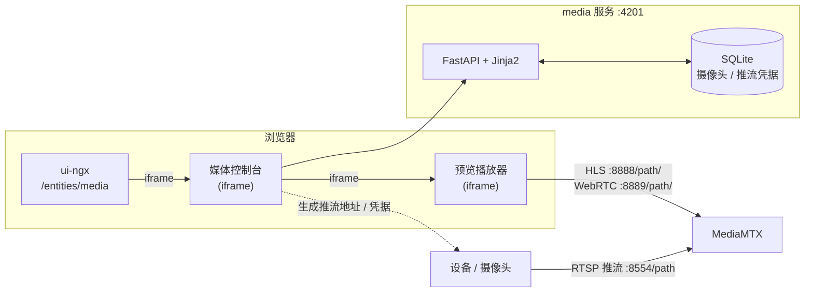
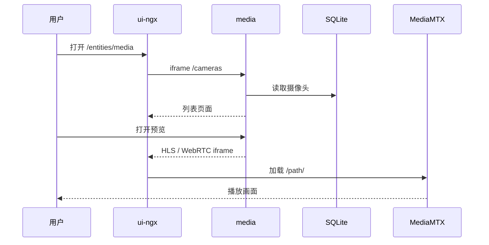

# 14 视频网关

> 中国中铁物联网平台文档集｜[总目录](../README.md)｜上一篇 [AI Agent 对话助手与 DSH 接入方案](11-AI-Agent对话助手方案.md)

视频网关是一个独立的 Python Web 服务（`media/`），用于管理摄像头、生成推流地址并预览 HLS / WebRTC 画面。页面通过 iframe 嵌入 `ui-ngx` 的 `/entities/media`，媒体流由 [MediaMTX](https://mediamtx.org/) 承担。

## 14.1 目标与边界

目标：

- 管理摄像头（路径、名称、位置、启用状态）。
- 按摄像头配置推流用户名/密码，生成 RTSP 推流地址。
- 通过 HLS 或 WebRTC 预览画面。
- 以服务端渲染页面嵌入 `ui-ngx`，与产品页面保持一致的交互与样式。

边界：

- 不运行 ffmpeg，不转码、不处理音视频。
- 不修改平台后端或平台数据库。
- 不负责在 MediaMTX 上创建用户；MediaMTX 认证需单独配置。
- 当前为内网使用，页面无登录鉴权。

## 14.2 总体架构



关键点：

- `media` 只提供管理页面与配置数据，不转发媒体流。
- 设备直接向 MediaMTX 推流；浏览器预览 iframe 直接访问 MediaMTX。
- 摄像头与推流凭据保存在 `media` 的 SQLite 中。

## 14.3 功能

### 14.3.1 摄像头管理

- 字段：`path`（自定义路径，如 `lzzz001`，唯一）、名称、位置、描述、启用状态。
- `path` 创建后锁定，不允许修改。
- 列表支持搜索、排序、分页，行点击打开编辑抽屉。

### 14.3.2 推流配置

- 每路摄像头单独配置推流用户名与密码。
- 生成的推流地址：

  ```text
  rtsp://<user>:<pass>@<host>:8554/<path>
  ```

- 设备或编码器使用该地址向 MediaMTX 推流。
- `media` 不创建 MediaMTX 用户；若 MediaMTX 开启认证，需要预先在 `mediamtx.yml` 中配置对应用户与发布权限。

### 14.3.3 画面预览

预览弹窗支持协议切换并复制地址：

```text
HLS:    http://<host>:8888/<path>/
WebRTC: http://<host>:8889/<path>/
```

WebRTC 需要浏览器能访问 MediaMTX 的 WebRTC 端口（默认 TCP `8889`；连通性不足时会使用 UDP `8189` 进行 ICE）。

### 14.3.4 交互时序



## 14.4 前端接入

| 项 | 内容 |
| --- | --- |
| 菜单 | 实体 → 网关 → 视频网关 |
| 路由 | `/entities/media` |
| 权限 | `TENANT_ADMIN` |
| 页面 | `ui-ngx/src/app/modules/home/pages/media/` |
| 菜单定义 | `ui-ngx/src/app/core/services/menu.models.ts` |
| 运行时配置 | `ui-ngx/src/assets/media.config.json` |

页面通过 iframe 加载 `consoleUrl`，默认：

```json
{
    "consoleUrl": "http://localhost:4201/cameras"
}
```

部署后可直接修改部署产物中的 `dist/assets/media.config.json`，无需重新构建前端：

```json
{
    "consoleUrl": "https://media.example.com/cameras"
}
```

建议对该文件设置 `Cache-Control: no-store`，避免浏览器缓存旧地址。

## 14.5 后端与数据

### 路由

| 方法 | 路径 | 说明 |
| --- | --- | --- |
| GET | `/cameras` | 视频网关列表页面 |
| POST | `/cameras` | 新增摄像头 |
| POST | `/cameras/{id}` | 更新摄像头与推流配置 |
| POST | `/cameras/{id}/delete` | 删除摄像头 |
| GET | `/api/cameras/{id}` | 编辑抽屉加载详情 |
| GET | `/health` | 健康检查 |

### `cameras` 表

| 字段 | 说明 |
| --- | --- |
| `id` | 自增主键 |
| `path` | 摄像头路径，唯一，创建后锁定 |
| `display_name` / `location` / `description` | 展示信息 |
| `enabled` | 是否启用 |
| `push_username` / `push_password` | 每路摄像头的推流凭据 |
| `push_protocol` | 当前固定 `rtsp` |
| `created_at` / `updated_at` | 时间戳 |

## 14.6 MediaMTX 前提

- 设备推流：

  ```text
  rtsp://<user>:<pass>@<host>:8554/<path>
  ```

- 预览：

  ```text
  HLS:    http://<host>:8888/<path>/
  WebRTC: http://<host>:8889/<path>/
  ```

- 若 `ui-ngx` 使用 HTTPS，HLS 与 WebRTC 也必须使用 HTTPS（或同源反向代理），否则会被浏览器混合内容策略拦截。
- MediaMTX 默认发布路径无需预定义；若开启认证，需要预置 `authInternalUsers`。

## 14.7 配置

| 变量 | 默认值 | 说明 |
| --- | --- | --- |
| `MEDIA_ROOT_PATH` | 空 | 反向代理到子路径时设置，例如 `/media-console` |
| `MEDIA_DB_PATH` | `./data/media.db` | SQLite 数据文件 |
| `MEDIA_MEDIAMTX_RTSP_HOST` | `129.211.239.229` | MediaMTX RTSP 主机 |
| `MEDIA_MEDIAMTX_RTSP_PORT` | `8554` | MediaMTX RTSP 端口 |
| `MEDIA_MEDIAMTX_HLS_PUBLIC_URL` | `http://129.211.239.229:8888` | HLS 地址前缀 |
| `MEDIA_MEDIAMTX_WEBRTC_PUBLIC_URL` | `http://129.211.239.229:8889` | WebRTC 地址前缀 |

完整配置见 `media/.env.example`。

## 14.8 部署

本地运行：

```powershell
cd media
Copy-Item .env.example .env
uv sync
uv run uvicorn app.main:app --host 0.0.0.0 --port 4201
```

Docker 与 Kubernetes 详见 `media/README.md` 与 `media/deploy/k8s/media.yaml`。

要点：

- 单副本运行（SQLite 单写），Deployment 使用 `Recreate` 策略。
- PVC 挂载到 `/data`，`MEDIA_DB_PATH=/data/media.db`。
- 推荐使用独立子域 Ingress（如 `media.example.com`），并把 `assets/media.config.json` 的 `consoleUrl` 指向 `https://media.example.com/cameras`。
- 若使用同域子路径 `/media-console`，需要 Ingress 重写并设置 `MEDIA_ROOT_PATH=/media-console`。

## 14.9 验证与排障

```bash
curl http://localhost:4201/health
cd media && uv run pytest
```

检查：

- `GET /health` 返回 `{"status": "ok"}`。
- 打开 `http://localhost:4201/cameras` 能看到列表。
- 打开 `http://localhost:4200/entities/media` iframe 正常加载。
- 配置推流后，`http://<host>:8888/<path>/` 可播放；WebRTC 地址同样可播放。

| 现象 | 排查 |
| --- | --- |
| iframe 空白 | 确认 `media` 已启动在 4201，且 `assets/media.config.json` 指向浏览器可达地址 |
| 预览黑屏 | 设备未推流或 HLS 地址不可达，先直接访问 HLS 地址验证 |
| 混合内容被拦截 | `ui-ngx` 为 HTTPS 时，media 与 HLS/WebRTC 也需要 HTTPS |
| 编辑后数据未保存 | 检查 SQLite 卷是否持久化、`MEDIA_DB_PATH` 是否正确 |
| WebRTC 无法连接 | 检查 8889/TCP 与 8189/UDP 可达性，必要时配置 TURN |

## 14.10 相关代码

| 模块 | 位置 |
| --- | --- |
| 服务入口 | `media/app/main.py` |
| 配置 | `media/app/config.py` |
| 路由 | `media/app/web/routes.py` |
| 数据访问 | `media/app/db.py` |
| 地址生成 | `media/app/utils.py` |
| 页面模板 | `media/app/templates/` |
| 前端 iframe 页面 | `ui-ngx/src/app/modules/home/pages/media/` |
| K8s 部署 | `media/deploy/k8s/media.yaml` |
