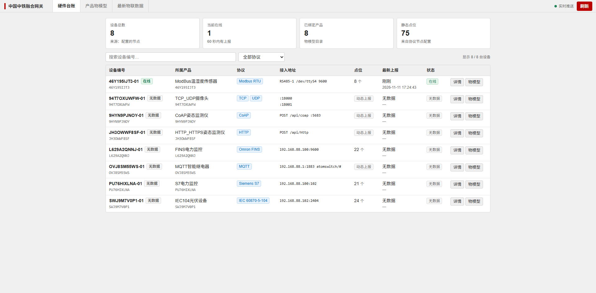
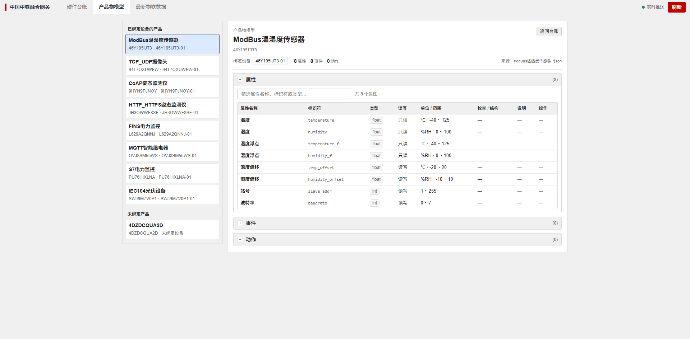

# 架构升级技术汇报

汇报人：王晔　王海波　郭文博　鲁众　　日期：2026 年 11 月

---

## 01 第一部分　信创与可扩展

### 自主可控的第一步，是把底座换掉

---

# 第一部分　信创与可扩展

## 02 技术选型：信创优先，开源可控

### 核心存储按信创要求选型：国产时序库 TDengine + 开源关系型数据库

| 存储 | 放什么 | 选型 | 信创属性 |
| --- | --- | --- | --- |
| 时序库 | 遥测、事件，按时间窗查询 | 国产 TDengine，一设备一子表 | 国产数据库，源码可控 |
| 关系型数据库 | 设备、产品、物模型、规则配置 | 开源关系型数据库 | 开源可自主部署，无商业授权 |

- **信创优先**：时序库选用国产 TDengine，关系型库选用开源方案，不引入商业授权组件
- **开源**：两类库均为开源软件，源码可获取，版本可自主掌控
- **安全可控**：可私有化部署，数据不出域；不绑定云服务，离线环境同样可运行

---

## 03 架构：核心组件可灵活扩容

### 平台网关、时序数仓、关系型数据库的扩容方式

| 核心组件 | 职责 | 扩容方式 |
| --- | --- | --- |
| 平台网关 | 设备接入、协议解析、规则处理与消息转发 | 加实例 / 加副本，前置负载均衡 |
| 时序数仓 | 遥测与事件存储、按时间窗查询 | 加节点 / 加副本，按时间分区 |
| 关系型数据库 | 设备与凭证、产品与物模型、规则配置 | 加实例 / 读写分离，按需升配 |

按瓶颈所在层独立扩容，不改业务代码、不改数据模型。

---

## 04 实测：3 万台设备接入

### 单集群 3 万台设备接入验证结果

- **实测规模**：单集群 3 万台设备，接入、校验、存储全链路
- **扩容对应关系**：接入压力对应平台网关加实例；写入与历史数据对应时序数仓加节点 / 分区；设备与产品数据增长对应关系型数据库加实例
- **架构影响**：上述扩容均不修改架构

| 场景 | 扩容动作 | 是否改架构 |
| --- | --- | --- |
| 接入压力上升 | 平台网关加实例 / 副本 | 否 |
| 时序数据膨胀 | 时序数仓加节点 / 时间分区 | 否 |
| 设备与产品数据增长 | 关系型数据库加实例 / 升配 | 否 |

---

## 05 第二部分　自主可控

### 源码、数据、架构、部署四个控制点

---

# 第二部分　自主可控

## 06 自主可控总览：四件事

### 源码、数据、架构、部署四项逐一说明

| 方面 | 关键点 | 验证依据 |
| --- | --- | --- |
| 源码 | 可修改、可发布、可回滚 | 内核源码、镜像仓库、回滚记录 |
| 数据 | 设备、时序与物模型的存放位置 | 自有关系型数据库、TDengine、Kafka |
| 架构 | 分层方式与版本归属 | 四层拓扑、线上 Pod 版本清单 |
| 部署 | 整体迁移可行性 | TKE 4 节点、3 个命名空间、迁移三步 |

---

## 07 源码可控

### 内核源码范围与发布方式

- **源码范围**：内核全量源码，覆盖接入、规则链、物模型与前端
- **发布方式**：自有流水线与私有镜像仓库，版本节奏与项目一致
- **回滚能力**：镜像与数据迁移均可回滚
- **依赖关系**：关系型数据库、TDengine、Kafka 均可自主部署，无强制云依赖

---

## 08 数据可控

### 数据存放位置

| 数据类型 | 落库位置 | 说明 |
| --- | --- | --- |
| 设备与凭证 | 自有关系型数据库 | 设备实例、访问令牌、网关关系 |
| 时序数据 | 自有 TDengine | 一设备一子表，可自主备份归档 |
| 物模型 / 产品 | 自有关系型数据库 | TSL 原文、版本、目录、校验和 |
| 规则与脚本 | 自有关系型数据库 + 规则链 | 按产品生成，随版本纳管 |
| 消息总线 | 自有 Kafka | 遥测 / 事件 / 异常数据三主题 |

---

## 09 平台架构：分层解耦、全栈容器化

### 四层解耦，部署形态为腾讯云 TKE 容器集群（4 节点）

---

## 10 技术选型与运行时拓扑

### 四层选型、组件版本与运行时链路，均取自线上运行态

| 层 | 组件栈 | 语言 / 框架 |
| --- | --- | --- |
| 平台内核 | tb-node 4.4.0-ztxk（规则引擎）· tb-js-executor ×8 · thing-model 20261105 · ai-agent 0.1.2 · ingest ×3 | Java 25 · Spring Boot 3.5 · Maven · Node.js · Python 3.12 / FastAPI |
| 前端 | tb-web-ui 4.4.0-ztxk-v22（Angular SPA）· 设备 / 资产 / 规则链 · AI 助手入口 · 全中文界面 | TypeScript 5.9 · Angular SPA · SCSS · Angular CLI |
| 基础设施 | TDengine 3.4.3.3 ×3 · Kafka 4.0.0 · Zookeeper 3.9 ×3 · Valkey 8.0 · Superset 5.0 | C / C++ 内核 · Java · Python 3 / Flask · SQL |
| 部署 | TKE · 4 节点 · 3 个命名空间 · 私有镜像仓库 · zeaho-gateway 域名入口 · MQTT / CoAP 独立 LB | K8s 原生 YAML（未用 Helm）· Dockerfile 多阶段构建 · Shell 运维脚本 |

---

## 11 部署可控

### 部署形态与迁移方式

- **现状**：腾讯云 TKE 集群（4 节点、3 个命名空间），全部组件容器化，镜像统一来自私有仓库
- **迁移范围**：仅替换仓库地址、存储类与网络出口，应用代码不改动
- **迁移三步**：镜像同步 → 清单替换 → 数据迁移演练
- **验证顺序**：先在测试集群完成验证，再切换至生产环境

---

## 12 第三部分　AI 辅助

### 建模型、改模型、调接口，执行权在人

---

# 第三部分　AI 辅助

## 13 AI 辅助总览

### 物模型维护、接口调用与执行边界

| 场景 | 能力 | 交付价值 |
| --- | --- | --- |
| A 物模型 | 导入物模型，AI 校验并生成产品 | 缩短新产品上线周期 |
| B 物模型演进 | 修改物模型、增加字段，AI 校验后发布 | 上线后改模型不用重建 |
| C 全量 API | 按产品创建设备；覆盖全部 REST API 并可生成示例代码 | 日常操作对话完成，开发对接有现成代码 |

- **全量覆盖**：平台所有 REST API 均已接入工具目录，而非仅覆盖常用接口
- **代码生成**：AI 可按调用场景生成示例代码（认证、请求体、错误处理），可直接用于开发
- **受控边界**：只读操作直连执行；写入操作生成待确认动作；高危操作二次确认并记录审计
- **权限边界**：沿用 JWT 与租户隔离，不绕过平台权限体系

---

## 14 演示 A：导入物模型并生成

### 导入物模型、校验并生成产品的操作步骤

1. 人工导入现有物模型文件（厂商提供或腾讯格式）
2. 平台自动识别格式并归一化为标准 TSL
3. AI 校验：结构、业务逐条给出问题与修正建议
4. 人工确认修正后保存，状态直接为已发布
5. 产品配置、产品资产、产品规则链自动生成

---

## 15 演示 B：修改物模型，增加字段

### 已上线产品增加字段的操作步骤

1. 打开已发布产品的物模型，提出新增字段（示例：新增"油耗"属性，单位 L，范围 0–500）
2. AI 校验新版本：字段命名、类型、范围、单位、与既有字段的冲突逐项检查
3. 人工确认后保存，生成新的 TSL 版本并发布
4. 平台同步更新产品配置、产品资产与规则链校验规则
5. 设备按新字段上报：平台校验通过、数据落库；旧字段不受影响

---

## 16 演示 C：全量 REST API 与示例代码

### 全部 REST API 调用与示例代码生成

| 能力 | 说明 |
| --- | --- |
| 全量 API 覆盖 | 平台所有 REST API 已入工具目录，覆盖设备、产品、物模型、规则链、告警、用户等 |
| 对话式调用 | 以自然语言定位接口并执行，写操作先生成待确认动作 |
| 代码生成 | 按调用场景生成示例代码：认证头、请求体、分页、错误处理 |
| 可扩展 | 新增接口仅需补充目录配置，无需修改助手插件 |

1. 输入"为产品 X 创建设备 demo_device_02，工点编码 DEMO"，查看待确认动作与风险等级
2. 确认执行，设备创建成功，服务端属性写入产品 ID、物模型版本、工点编码
3. 追加指令"生成该调用的 Python 示例代码"，AI 输出可直接运行的脚本

---

## 17 第四部分　融合终端与更多物联网设备都可无缝接入

### 多协议直连、统一物模型、一套接入逻辑

---

# 第四部分　融合终端与更多物联网设备都可无缝接入

## 18 五类设备，一条接入主线

### 五类设备的接入方式与平台侧处理

| 设备类型 | 典型场景 | 接入方式 | 平台侧统一 |
| --- | --- | --- | --- |
| 工业协议设备 | PLC、DCS、数控、工程机械 | 平台直接对接 OPC-UA / S7 / CAN | 统一物模型 + 规则链校验 |
| 融合终端 | 多协议聚合、边缘采集 | 终端直连，无中转服务 | 子设备按标准设备对象纳管 |
| 直连设备 | 智能表计、车载终端、自研硬件 | 标准 MQTT 直连 | 同一套主题与认证 |
| 低功耗设备 | 传感器、电池供电节点 | 轻量上报，平台侧统一校验 | 设备端不承担校验逻辑 |
| 存量设备 | 腾讯云 IoT 存量终端 | 按原协议上报，平台归一化 | 迁移不改设备端 |

- **统一主线**：设备形态与接入路径不同，最终统一落到"设备 + 物模型 + 规则链"体系
- **覆盖范围**：工业总线、无线终端、低功耗节点、存量终端均可覆盖
- **平台侧**：仅维护一套模型、一套校验、一套数据链路

---

## 19 工业协议：平台直接对接

### 工业协议对接方式与融合终端定位

物联网平台可直接对接 OPC-UA / S7 / CAN 等工业协议，现场设备无需先接入第三方采集或转换系统。

- **对接位置**：工业协议接入能力属于平台，融合终端作为平台边缘接入组件随平台交付
- **读取方式**：OPC-UA 按节点读取、S7 直接读取 DB 块、CAN 解析短帧，采集在边缘完成
- **协议收敛**：协议差异在边缘层消化，对上统一采用平台标准接入
- **扩展方式**：协议以连接器方式接入，新增协议仅需扩展连接器

| 协议 | 典型对象 | 接入方式 |
| --- | --- | --- |
| OPC-UA | PLC、DCS、产线控制 | 按节点读取，结构化工艺参数 |
| S7 | 西门子系列设备 | 直接读 DB 块，存量产线低成本改造 |
| CAN | 车载、工程机械、控制器 | 解析高频短帧运行数据 |
| 后续扩展 | Modbus 等更多工业协议 | 以连接器方式接入，按需扩展 |

---

## 20 统一物模型：一份模型，贯穿所有设备

### 终端与直连共用同一份 TSL

统一物模型：终端仅完成点位到字段的映射，子设备沿用产品物模型。

- **模型复用**：子设备的属性、事件、行为沿用产品物模型定义，同型号更换终端无需重建模型
- **校验一致**：终端上报同样经产品规则链校验，类型、范围、枚举、必填项均不缺失
- **链路一致**：与直连设备使用同一 Kafka 主题、写入同一时序数据库
- **横向复用**：同一产品在多个工点、多台终端共用一份模型
- **上层无差异**：规则、告警、看板、API 均按统一模型工作

---

## 21 单跳直连：终端直连平台

### 融合终端直连平台，链路不设中转服务

终端直连平台上报数据，无需部署额外中转服务或消息中间队列。

- **直连方式**：终端 MQTT 客户端直连平台网关模式，平台原生支持网关主题与子设备包含关系
- **链路组成**：设备 → 融合终端 → 平台，共三段
- **现场影响**：减少一台设备、一项运维对象与一次跨系统排障

| 对比项 | 传统"网关 + 中转服务" | 融合终端直连 |
| --- | --- | --- |
| 部署单元 | 网关 + 中转 + 队列 | **仅终端** |
| 故障点 | 多一层，跨系统排障 | **单跳** |
| 子设备建模 | 中转侧再维护一套映射 | **平台侧标准物模型** |
| 扩容 | 中转层跟着扩 | **边缘加终端即可** |

---

## 22 多语言 MQTT：标准协议，生态成熟

### 标准 MQTT 协议与各语言客户端库

上报数据采用标准 MQTT 协议，不绑定私有 SDK；主流语言均有成熟客户端库可直接对接。

| 语言 / 场景 | 推荐客户端库 | 说明 |
| --- | --- | --- |
| 跨语言基础 | Eclipse Paho | 官方与社区覆盖 Java、Python、JS、Go、C/C++、Rust、C#、Android、Embedded |
| Python | paho-mqtt / gmqtt | 官方客户端；异步场景可用 gmqtt |
| Java | Paho Java / Android Service | 同步与异步 API；Android 端管理后台服务生命周期 |
| Go | paho.mqtt.golang | 官方 Go 实现，贴近 Go 生态 |
| JavaScript | MQTT.js / Paho JS | Node.js 与浏览器均可用 |
| C / C++ | Paho C / Paho C++ / wolfMQTT | 嵌入式与高性能场景；wolfMQTT 体积小、支持 TLS 1.3 |
| Rust | rumqttc | 纯 Rust、Tokio 异步运行时 |

- **协议版本**：平台支持 MQTT 3.1.1，兼容 5.0；具体客户端库对 5.0 的支持需按版本确认
- **对接步骤**：连接地址与端口 → 设备令牌认证 → 按物模型字段上报，共四步
- **SDK 依赖**：不引入平台自定义封装，避免版本锁定与升级耦合

---

## 23 融合终端：设备直连平台

### 终端以网关模式直连平台，子设备按标准设备对象纳管

设备列表可见融合终端与其下属子设备，均作为标准设备对象存在，可直接检索、授权、配置。

---

## 24 一套标准物模型通用

### 子设备沿用产品标准物模型，终端只做点位到字段的映射

同一份标准物模型同时适用于终端与子设备，同型号设备更换终端无需重建模型。

---

## 25 第五部分　腾讯云 IoT 兼容与拓展

### 存量可迁、数据可用、能力可拓展

---

# 第五部分　腾讯云 IoT 兼容与拓展

## 26 对接方式对比：标准协议，接入路径更短

### 腾讯云 IoT 与平台接入方式对比

| 对接维度 | 腾讯云 IoT | 本平台 |
| --- | --- | --- |
| 物模型 | TSL 规范 | 兼容腾讯 TSL，可直接导入 |
| 通信协议 | 标准 MQTT | 标准 MQTT，兼容 3.1.1 / 5.0 |
| 客户端 | 官方 SDK | 各语言标准 SDK（Paho / MQTT.js 等），无需私有 SDK |
| 硬件接入 | 模组 SDK 或 AT 指令 | Cat.1 模组 AT 指令可直连，无需额外网关 |
| 迁移改造 | — | 设备端协议与报文格式不变，仅切换平台地址 |

- **标准 SDK**：Java、Python、Go、JS、C/C++、Rust 均有成熟客户端库，直接对接
- **AT 指令直连**：Cat.1 等蜂窝模组可通过 AT 指令完成连接与上报，适合低成本终端
- **无需私有封装**：不引入平台自定义 SDK，避免版本锁定与升级耦合

---

## 27 物模型归一化

### 腾讯侧物模型导入方式

- **归一化规则**：属性、事件、行为映射到平台标准 TSL
- **保留内容**：类型、范围、单位、枚举、结构体层级
- **识别方式**：依据腾讯格式的 define 特征判断，无需人工声明
- **导入入口**：标准 TSL 与腾讯格式共用导入入口
- **设备端改动**：设备继续按原 MQTT 主题与报文格式上报，迁移仅更换平台

字符串型 min/max 等源数据元信息默认按规范丢弃，如需保留可通过参数开启，不改动语义。

---

## 28 时序数据灵活加工与下游对接

### 时序数据处理方式与下游对接方式

- **处理方式**：按业务需要编写代码查询、加工时序数据，不受固定报表模板限制
- **计算方式**：聚合、窗口、关联、补点等逻辑均可通过修改代码调整，无需等待产品版本
- **交付方式**：结果可通过消息队列、API 接口、直接写入业务数据库等方式输出
- **数据链路**：原始数据留存平台，加工结果按需分发，上游改动不影响下游

| 下游对接方式 | 适用场景 | 特点 |
| --- | --- | --- |
| 消息队列 | 下游系统异步消费、多系统广播 | 解耦、可缓冲、易扩展 |
| API 接口 | 业务系统按需查询、前端展示 | 实时、按权限控制 |
| 直接写入业务库 | 报表、台账、历史归档 | 落地稳定，便于二次分析 |

---

## 29 演示 E：全流程验证

### 导入、校验、同步流程

1. 上传腾讯格式物模型：自动识别并归一化
2. 结构校验 + 业务校验：0 问题
3. 创建产品并同步：产品配置、资产、规则链自动生成
4. 用原腾讯格式报文上报：不改字段，正常校验并落库

---

## 30 第六部分　后续拓展

### AI 辅助先行，其余方向按同一模式推进

---

# 第六部分　后续拓展

## 31 后续拓展

### WorkBuddy 等 AI 工具的接入方式

AI 辅助

| 接入要素 | 平台侧对应能力 | 说明 |
| --- | --- | --- |
| 标准接口 | 统一 OpenAPI 与工具目录 | 封装为 MCP Server，供 AI 助手调用 |
| 接入方案 | MCP + Skill（推荐）/ CLI + Skill | 平台提供 HTTP API，优先采用 MCP 方案 |
| 交付物 | Connector 包：元信息 · 连接配置 · Skill · 图标 | 按 WorkBuddy 规范打包并提交审核 |
| 认证 | OAuth / 用户填写凭证 | 私有化部署可填写内网服务地址 |

- **定位**：平台能力成为 WorkBuddy 生态的标准连接器
- **管控方式**：写操作仍经待确认与审计，不改变设备接入、物模型与权限体系
- **拓展方式**：设备接入、应用对接、运维保障按同一模式推进

---

## 32 附录　现场演示手册

### 六项演示，覆盖接入、模型、告警与计算

---

# 附录　现场演示手册

## 33 现场演示菜单：建议顺序

### 六项演示内容与顺序

| 顺序 | 演示场景 | 现场动作 | 建议时长 |
| --- | --- | --- | --- |
| 1 | 设备接入三协议 | DLT645 电表 MQTT / HTTP / CoAP 模拟器各上报一包数据 | 3 分钟 |
| 2 | 网关与子设备 | 网关上线 → 子设备注册 → 数据上报 → 下行 RPC | 3 分钟 |
| 3 | 产品与物模型 | 导入腾讯 TSL → 校验 → 生成产品配置、资产与规则链 | 2 分钟 |
| 4 | 批量开设备 | 批量注册工具创建设备并导出凭证 | 2 分钟 |
| 5 | 告警与通知 | 触发告警 → 告警中心确认 → 发送通知 | 2 分钟 |
| 6 | 计算字段 | 打开计算字段，配置表达式 → 查看输出指标 | 2 分钟 |

---
