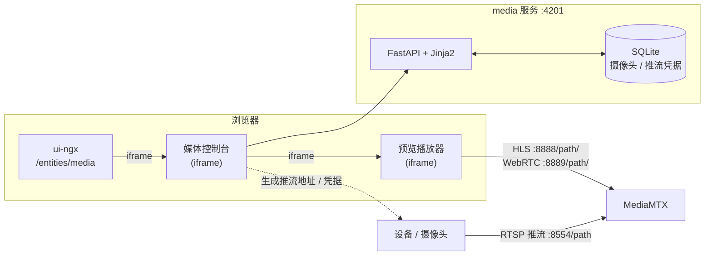

# ThingsBoard Media Console

独立 Python 视频网关控制台，用于管理摄像头、配置推流凭据并预览 HLS / WebRTC 画面。

该服务通过 iframe 嵌入 `ui-ngx` 的 `/entities/media` 页面，流媒体本身由 [MediaMTX](https://mediamtx.org/) 承担。

## 架构



- `media` 不运行 ffmpeg，不处理音视频，只保存摄像头与推流凭据、生成推流地址、渲染管理页面。
- 设备直接向 MediaMTX 推流；页面通过 MediaMTX 的 HLS 或 WebRTC 预览。
- 摄像头与凭据保存在 SQLite 中。

## 技术栈

- Python 3.12
- uv
- FastAPI
- Jinja2（服务端渲染）
- SQLite（Python 标准库）
- uvicorn
- pytest

## 目录结构

```text
media/
├── app/
│   ├── main.py                 FastAPI 入口
│   ├── config.py               MEDIA_* 配置
│   ├── db.py                   SQLite 访问
│   ├── models.py               路径校验
│   ├── utils.py                推流/预览地址生成
│   ├── web/routes.py           页面与接口路由
│   ├── templates/              Jinja2 模板
│   └── static/                 CSS / JS / 字体
├── tests/
├── deploy/k8s/media.yaml       Kubernetes 部署
├── pyproject.toml
├── uv.lock
├── .python-version
├── .env.example
├── Dockerfile
└── README.md
```

## 环境要求

- Python 3.12
- uv

## 本地启动

```bash
cd media
uv sync
cp .env.example .env
uv run uvicorn app.main:app --host 0.0.0.0 --port 4201
```

Windows PowerShell：

```powershell
cd media
Copy-Item .env.example .env
uv sync
uv run uvicorn app.main:app --host 0.0.0.0 --port 4201
```

访问：

```text
http://localhost:4201/cameras
```

## 配置

| 变量 | 默认值 | 说明 |
| --- | --- | --- |
| `MEDIA_ROOT_PATH` | 空 | 反向代理到子路径时设置，例如 `/media-console` |
| `MEDIA_DB_PATH` | `./data/media.db` | SQLite 数据文件 |
| `MEDIA_MEDIAMTX_RTSP_HOST` | `129.211.239.229` | MediaMTX RTSP 主机（用于生成推流地址） |
| `MEDIA_MEDIAMTX_RTSP_PORT` | `8554` | MediaMTX RTSP 端口 |
| `MEDIA_MEDIAMTX_HLS_PUBLIC_URL` | `http://129.211.239.229:8888` | 浏览器可访问的 HLS 地址前缀 |
| `MEDIA_MEDIAMTX_WEBRTC_PUBLIC_URL` | `http://129.211.239.229:8889` | 浏览器可访问的 WebRTC 地址前缀 |

完整配置见 `.env.example`。

## 运行说明

- **单实例**：SQLite 为单写数据库，K8s 中固定 `replicas: 1`，并使用 `Recreate` 策略避免 RWO 卷多挂载。
- **无鉴权**：当前面向内网使用，页面没有登录。
- **推流凭据**：在页面“推流配置”中按摄像头录入，保存在 SQLite，不通过环境变量提供。
- **MediaMTX 用户**：`media` 不负责在 MediaMTX 上创建用户。若 MediaMTX 开启了认证，需要预先在 `mediamtx.yml` 的 `authInternalUsers` 中配置对应用户与发布权限。

## Docker

构建并推送镜像：

```bash
docker build -t <registry>/tb-media:<tag> ./media
docker push <registry>/tb-media:<tag>
```

运行：

```bash
docker run -d --name tb-media \
  -p 4201:4201 \
  -v media-data:/data \
  -e MEDIA_DB_PATH=/data/media.db \
  -e MEDIA_MEDIAMTX_RTSP_HOST=129.211.239.229 \
  -e MEDIA_MEDIAMTX_RTSP_PORT=8554 \
  -e MEDIA_MEDIAMTX_HLS_PUBLIC_URL=http://129.211.239.229:8888 \
  <registry>/tb-media:<tag>
```

容器内监听 `4201`，健康检查为 `GET /health`。

## Kubernetes

参考 `deploy/k8s/media.yaml`，包含 ConfigMap、PersistentVolumeClaim、Deployment、Service 和 Ingress。

1. 构建并推送镜像（见上一节）。
2. 修改 `media.yaml` 中的占位符：
   - `<namespace>`
   - `<registry>` / `<tag>`
   - `media.example.com`（Ingress 域名）
   - `media-tls`（TLS Secret）
   - MediaMTX 地址（`MEDIA_MEDIAMTX_*`）
3. 应用：

   ```bash
   kubectl -n <namespace> apply -f media/deploy/k8s/media.yaml
   kubectl -n <namespace> rollout status deployment/media
   ```

4. 检查：

   ```bash
   kubectl -n <namespace> get pods,svc,ingress
   ```

要点：

- Deployment 将 PVC `media-data` 挂载到 `/data`，`MEDIA_DB_PATH=/data/media.db`。
- Ingress 默认使用独立子域 `media.example.com`，根路径转发到 `media:4201`，因此 `MEDIA_ROOT_PATH` 保持为空。
- 若必须使用同域子路径（如 `/media-console`），需要 Ingress rewrite 去掉前缀，并设置 `MEDIA_ROOT_PATH=/media-console`。
- Ingress 依赖集群的 ingress controller（示例为 `nginx`）。没有 Ingress 时可改用 NodePort 或网关转发 Service `media:4201`。

## 与 ui-ngx 集成

- 菜单入口：`实体 → 网关 → 视频网关`，路由 `/entities/media`。
- 页面通过 iframe 加载 `media` 控制台，地址来自运行时配置：

  ```text
  ui-ngx/src/assets/media.config.json        # 源文件，默认 http://localhost:4201/cameras
  dist/assets/media.config.json             # 部署产物，可部署后直接修改
  ```

  生产示例：

  ```json
  {
      "consoleUrl": "https://media.example.com/cameras"
  }
  ```

- 该配置在运行时读取，修改部署产物中的 `assets/media.config.json` 即可生效，无需重新构建前端。建议对该文件设置 `Cache-Control: no-store`，避免浏览器缓存旧地址。

## MediaMTX 前提

- 设备向 MediaMTX 推流，RTSP 地址格式：

  ```text
  rtsp://<user>:<pass>@<host>:8554/<path>
  ```

  在“视频网关”页面为每路摄像头填写推流用户名/密码后，复制生成的推流地址配置到设备。
- 预览地址（页面“预览”弹窗中可切换 HLS / WebRTC 并复制地址）：

  ```text
  HLS:    http://<host>:8888/<path>/
  WebRTC: http://<host>:8889/<path>/
  ```

- WebRTC 预览还需要浏览器能访问 MediaMTX 的 WebRTC 端口（默认 TCP `8889`；连通性不足时 MediaMTX 还会使用 UDP `8189` 进行 ICE）。

- 若 `ui-ngx` 使用 HTTPS，`media` 与 HLS 也必须使用 HTTPS（或同源反向代理），否则浏览器会因混合内容拦截 iframe。

## 健康检查

```text
GET /health  ->  {"status": "ok"}
```

## API

| 方法 | 路径 | 说明 |
| --- | --- | --- |
| GET | `/cameras` | 视频网关列表页面 |
| POST | `/cameras` | 新增摄像头 |
| POST | `/cameras/{id}` | 更新摄像头与推流配置 |
| POST | `/cameras/{id}/delete` | 删除摄像头 |
| GET | `/api/cameras/{id}` | 编辑抽屉加载摄像头详情 |
| GET | `/health` | 健康检查 |

## 测试

```bash
cd media
uv run pytest
```

## 常见问题

- **iframe 空白**：确认 `media` 已在 `4201` 端口运行，且 `assets/media.config.json` 的 `consoleUrl` 指向浏览器可访问的地址。
- **`localhost` 含义**：生产环境中的 `localhost` 指用户浏览器所在机器，应改为服务器实际域名或 IP。
- **预览黑屏**：设备尚未推流，或 HLS 地址不可达；先直接访问 `http://<host>:8888/<path>/` 验证。
- **混合内容**：HTTPS 页面不能嵌入 HTTP 子页面；为 `media` 和 MediaMTX HLS 配置 HTTPS。
- **多副本问题**：不要将 `replicas` 调大；SQLite 不适合多实例并发写入。
- **配置未生效**：浏览器可能缓存了 `media.config.json`，请配置 `no-store` 或强制刷新。
