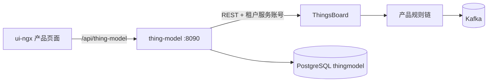
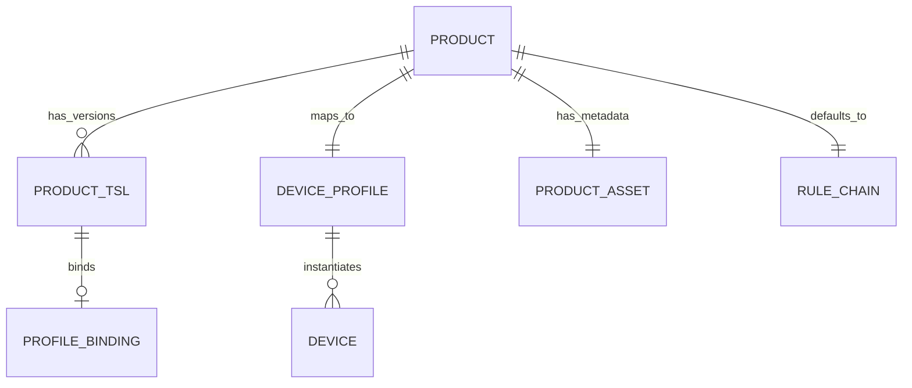

# thing-model 实现评审

> 本文以当前代码为准，设计细节见 [docs/](../docs/)。

## 1. 定位

`thing-model` 是独立 Spring Boot 服务，不修改 ThingsBoard 源码，不加入 ThingsBoard 根 Maven reactor。



职责：

- 产品与 TSL 版本管理；
- TSL 校验和压缩 schema；
- Device Profile、产品 Asset、产品规则链同步；
- 租户厂商服务账号管理；
- 产品规则链的 Kafka 消息生成。

不负责：

- 设备开通 API；
- 组织树、工点、台账；
- 事件中心；
- TDengine 入湖；
- 开放 API、OTA、设备 SDK。

## 2. 实体关系



| 关系 | 基数 | 承载位置 |
| --- | --- | --- |
| 产品 -> TSL 版本 | 1:N | `plat_product_tsl` |
| 产品 -> Device Profile | 1:1 | ThingsBoard Device Profile |
| 产品 -> 产品 Asset | 1:1 | ThingsBoard Asset |
| 产品 -> 规则链 | 1:1 | ThingsBoard Rule Chain |
| Device Profile -> 设备 | 1:N | ThingsBoard Device |
| TSL 版本 -> 同步绑定 | 1:0..1 | `plat_profile_binding` |

关键结论：

1. 产品是业务主数据，Device Profile 是 ThingsBoard 设备模板。
2. 产品 Asset 只承载 TSL 元数据，不是设备台账。
3. ProductId 全系统唯一，不同租户也不能重复。
4. 设备由 ThingsBoard 或运维脚本管理，`thing-model` 不维护设备清单。
5. 规则链校验使用发布时内嵌的压缩 schema，不依赖设备上的 `tsl_schema`。

## 3. 权限模型

| 接口 | 角色 | 数据范围 |
| --- | --- | --- |
| `/api/products/**` | `TENANT_ADMIN` | JWT 对应租户 |
| `/api/admin/**` | `SYS_ADMIN` | 指定租户 |
| `/api/auth/me` | 任意已登录用户 | 当前用户 |

- 产品接口不接受跨租户 tenantId。
- 跨租户产品详情返回 404。
- `SYS_ADMIN` 不显示产品菜单，调用产品 API 返回 403。
- 写 ThingsBoard 使用目标租户的服务账号，不使用 SYS_ADMIN 代替厂商账号。

## 4. 同步与失败处理

```text
校验 TSL
  -> 检查租户服务账号
  -> 保存 DRAFT
  -> 生成压缩 schema
  -> 确保规则链
  -> 保存 Device Profile
  -> 保存产品 Asset
  -> 写 Asset 属性
  -> 保存绑定并置 PUBLISHED
```

- 同步在 HTTP 请求内完成。
- 同步失败保留 DRAFT 并写 `sync_result`。
- `/api/products/{productId}/sync` 可重试。
- 没有异步任务、差异对比、自动补偿和版本回滚。

## 5. 规则链

- 名称等于 ProductId。
- 兼容旧名称 `auto_<ProductId>_telemetry`。
- 绑定 Device Profile 的 `defaultRuleChainId`。
- 14 个节点、14 条连接。
- 校验失败数据只投 `iot.invalid`。
- 合法遥测写 ThingsBoard 时序库后再投 Kafka。
- Kafka topic 固定为 `iot.telemetry.normalized`、`iot.event.normalized`、`iot.invalid`。

## 6. 当前风险与限制

- 产品同步是同步调用，ThingsBoard 变慢会直接拉长请求。
- 规则链脚本变更后必须对产品执行同步，重启服务不会刷新。
- 产品列表没有服务端分页。
- 没有产品弃用、回滚和灰度。
- 自动初始化租户账号依赖 ThingsBoard 激活接口和邮箱域名。
- 外部 Kafka 和 TDengine 的可用性不属于本服务保证范围。
- 入湖和事件中心由外部工程负责，本仓库只定义 Kafka 消息契约。
